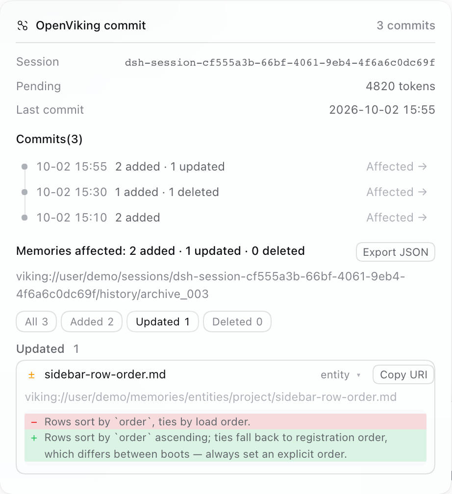
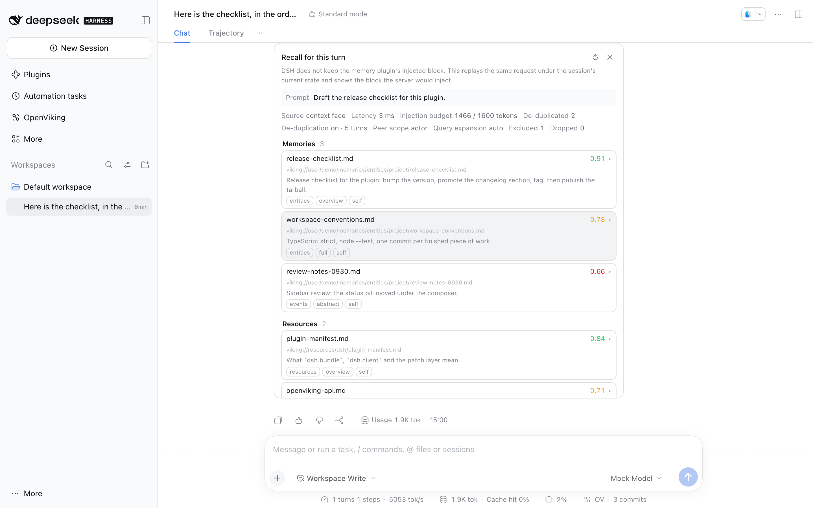
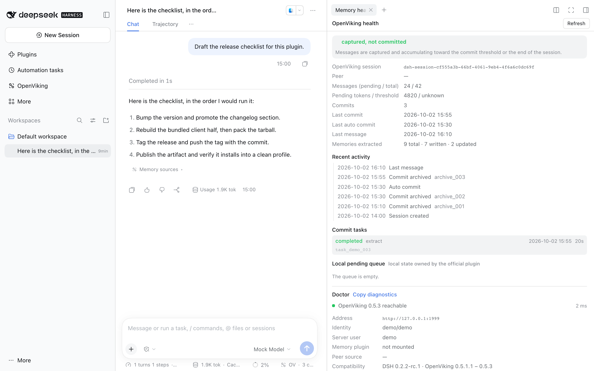
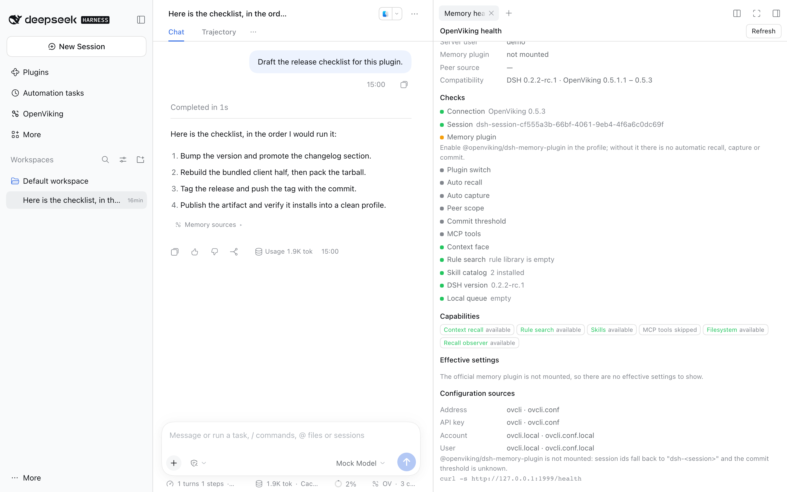
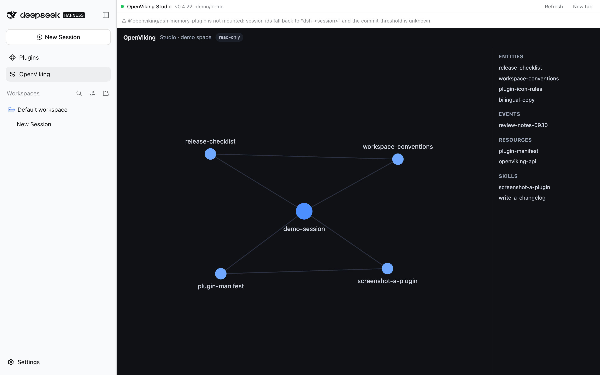
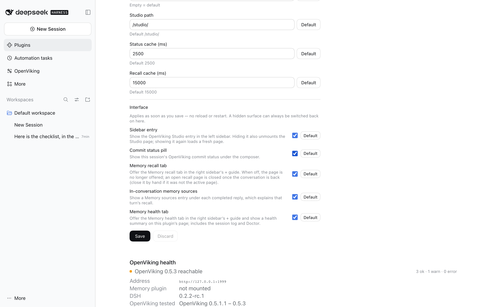

# dsh-openviking-enhance

English | [中文](README.zh.md)

**v0.3.0** · [Changelog](CHANGELOG.md)

Brings your local [OpenViking](https://docs.openviking.ai) memory server into the
DeepSeek Harness (DSH) Web GUI: a Studio panel in the left sidebar, a commit
status pill and diff browser under the message box, a per-turn explanation of
what the memory plugin retrieved, and a Memory health tab that answers "why is
this memory session not working?".

Nothing needs to be patched in DSH or in the OpenViking plugin — it mounts as an
ordinary DSH bundle.

## What you get

**OpenViking Studio, inside DSH.** A new row at the bottom of the left sidebar
opens the OpenViking server's own Studio UI in the main area, so you can browse
memories, sessions and retrieval without leaving the app or switching to a browser.

**Per-session commit status.** OpenViking writes memory in *commits*: a session's
turns accumulate until a token threshold is reached (or the session ends), then
they are archived and the memories are extracted. The pill under the message box
tells you where the session you are looking at stands.

The pill follows the app's language (see *Notes*); in English it reads:

| Pill | Meaning |
| --- | --- |
| `OV · not committed` | Nothing from this session has been committed yet |
| `OV · 12.3k/20k` | Turns are accumulating towards the commit threshold |
| `OV · extracting…` | A commit is being archived and its memories extracted |
| `OV · 3 commits` | Three commits so far |
| `OV · extraction failed` | The newest commit was archived but its memories could not be extracted |
| `OV · cancelled` | The newest commit was cancelled before its memories were extracted |
| `OV · unavailable` | The local OpenViking server cannot be reached |

Click the pill for details:

- a **timeline** of the most recent 3 commits — when each happened, whether its
  extraction finished or failed, and how many memories it added, updated or
  deleted (the rest are one click away);
- clicking a commit opens a **diff browser**: filter by added, updated or
  deleted, expand any change to see its before/after text with a line diff, copy
  a `viking://` URI, or export the commit as JSON:

  
- any **failed extraction**, with the time, the server error and the task id
  while the task record is still retained, plus a copy-error control. Failures
  older than the newest commit stay listed there without changing the pill.

The panel and the pill read only. This plugin never commits, writes or deletes
anything in OpenViking.

**What this session retrieves.** The right sidebar gains a *Memory recall* tab: it shows what OpenViking pulls in for the session you are looking at
— the query it searched with (that session's most recent message, or one you type
yourself), every hit in each of its three sources (memories, resources, skills)
with its score — graded from red through orange to green — its file name, its kind
(`entity`, `event`, …) and its abstract. The full `viking://` path is on hover, and
opening a row loads that entry's whole text. The plan the server retrieved with is there
too. Open it from the right sidebar's `+`
guide; it is per session, like the column itself.



**Why did this turn use that memory?** Under every completed reply the
conversation gains a small *Memory sources* entry. Opening it replays that
turn's prompt against the server's context face and shows the query, every hit
with its score, category, `viking://` URI, read tier and provenance, the token
budget (used/max), quotas, tier counts, exclusions, cross-turn de-duplication,
the retrieval plan and the assembled injection block.

The card is explicit that it is a **replay**: DSH does not retain the memory
plugin's injected block, so claiming to show the historical injection would be
false. Servers without the context face fall back to the per-target search and
say so.



**Is this session being captured?** A second right-sidebar tab, *Memory health*,
answers the five questions that used to require guessing: nothing captured,
captured but not committed, extracting after a commit, extraction failed, or
writes queued locally. It shows messages, pending tokens and the threshold,
commits, last commit and last auto-commit, recent tasks, and a timestamped
activity timeline. It also reads the official plugin's local pending queue
(counts, types and times only — never payloads).

**Why is it not working?** The same tab carries the **Doctor**: endpoint,
health, server version, identity, the mounted memory plugin's version and
effective recall/capture/commit settings, where each connection value came from
(profile override, environment, `ovcli.conf`/`.local`, or default), and live
probes for the context face, rule search, skills, the model-visible
`mcp__openviking__*` tools, `fs/stat` and retrieval metrics. Every check points at
a likely fix, and the diagnostic JSON or
`curl /health` command is one click away. API keys are never included.



The plugin's own page under **Plugins** also gets a compact health summary, so
"is it working?" can be answered without opening a session.



The Studio panel, the sidebar row that opens it, and the commit pill below the composer.

## Requirements

| | |
| --- | --- |
| DSH | 0.2.0-rc.2 or newer (desktop or web profile; verified on 0.2.2-rc.1) |
| OpenViking | A local server; 0.5.1.1–0.5.3 tested (0.5.3 with the context face). Studio is served at `/studio/` on the same port |
| Memory plugin | `@openviking/dsh-memory-plugin` recommended — it is what commits sessions. Without it the panel still works, but pending-token thresholds are unknown |

## Install

Install it from the Plugins page (Add plugin → package name or tarball), or:

```bash
# from npm
dsh plugin --profile desktop add dsh-openviking-enhance

# or the prebuilt tarball from the latest release
dsh plugin --profile desktop add https://github.com/A2chitect/dsh-openviking-enhance/releases/latest/download/dsh-openviking-enhance.tgz
```

Installing straight from a Git URL is refused by pnpm — the package asks to run a
build script and pnpm blocks those until they are allowed — so a source checkout is
installed as a tarball instead. The client half is a prebuilt bundle: a source
install would have nothing to load.

```bash
pnpm pack && dsh plugin --profile desktop add ./dsh-openviking-enhance-<version>.tgz
```

Then restart the DSH app once: the host half is loaded at startup. To remove it:

```bash
dsh plugin --profile desktop remove dsh-openviking-enhance
```

## Configuration

Everything has a sensible default — a standard local setup needs no configuration
at all. To change something, open **Plugins** in the sidebar, pick this plugin, and
use **Configure** on its row: the form carries the fields below, a **check**
button that probes the address before you save, and a *default* button per field
that clears the override instead of writing an empty value.

The same settings can still be written by hand in your profile's patch file
(`~/.dsh/profiles/desktop/cordis.patch.yml`), under the row `openviking-enhance`:

```yaml
- id: openviking-enhance
  name: 'dsh-openviking-enhance'
  config:
    endpoint: http://127.0.0.1:1933
```

| Field | Default | Meaning |
| --- | --- | --- |
| `endpoint` | from `~/.openviking/ovcli.conf`, else `http://127.0.0.1:1933` | OpenViking base URL |
| `apiKey` | from `ovcli.conf` | Only needed if the server requires authentication |
| `account` / `user` | `default` / `default` | Identity the panel reads under |
| `studioPath` | `/studio/` | Where Studio is served on that origin |
| `cacheTtlMs` | `2500` | How long a status answer is reused |
| `recallCacheTtlMs` | `15000` | How long one retrieval answer is reused |
| `showSidebarEntry` | `true` | Interface switch: the OpenViking entry in the left sidebar |
| `showCommitStatus` | `true` | Interface switch: the commit status pill under the message box |
| `showRecallPanel` | `true` | Interface switch: the Memory recall tab in the right sidebar |
| `showRecallExplain` | `true` | Interface switch: the per-turn Memory sources entry in the conversation |
| `showHealthPanel` | `true` | Interface switch: the Memory health tab and the Plugins-page health summary |



The five **interface switches** control the five surfaces independently. They
take effect as soon as you save — the GUI mounts or unmounts the surface without
a reload or a restart. The **Configure** form itself is never hidden, so a
surface switched off can always be switched back on there. Hiding the sidebar
entry also unmounts the Studio page (it loads fresh when shown again), and hiding
the recall tab closes an open recall page as soon as the conversation is back
on screen — a page that is open in a background pane has to be closed by hand,
because the harness exposes no way to enumerate tabs.

## Troubleshooting

**No OpenViking row in the sidebar, or no pill under the message box.**
First check the plugin's own switches (Plugins → this plugin → **Configure** →
*Interface*): a surface may be switched off, and the switches are independent.
Otherwise the client half is served as a file and picked up on page load. Reload
the window (⌘R). If it is still missing, restart the app.

**I hid the OpenViking row / pill / recall tab / explanation / health tab and want it back.**
Open **Plugins** → *dsh-openviking-enhance* → **Configure** on its row and switch
it back on, then save. That form is always available, even with all five
surfaces hidden.

**The panel says it cannot reach OpenViking.**
Start the server and check it directly: `curl http://127.0.0.1:1933/health`. The
panel shows the address it tried, which helps when `endpoint` is not the default.

**The pill says extraction failed.**
The commit was archived but OpenViking could not turn it into memories — those
memories are not in your library. Click the pill for the server's own error; it is
usually a problem with the extraction model configured in `~/.openviking/ov.conf`.

**No memories appear in a reply, or a recall is empty.**
Open *Memory health* → *Doctor*: it distinguishes an unreachable server, a missing
or disabled memory plugin, recall/capture being off, an unknown commit threshold,
a legacy server without the context face, and a local write queue. Then open the
*Memory recall* tab and search the same prompt to see the server's own ranking.

**The pill shows a token count instead of a commit count.**
`@openviking/dsh-memory-plugin` is not installed, so the commit threshold is
unknown. Commits themselves still work; only the progress denominator is missing.

**The timeline shows only 3 commits.**
That is the default. Click *show all*.

**There is no recall or Memory health tab in the right sidebar.**
The tabs are reached through that column's own `+` guide, and they only exist
after a window reload (the client half is a file the page loads). If DSH is older
than 0.2.0-rc.2 it has no right sidebar to contribute to: the rows are skipped and
the Studio panel and the pill keep working.

**I changed the code and nothing happened.**
The two halves reload differently: the client half after a window reload, the host
half only after an app restart.

## Notes

- **The plugin's own text follows the app's language.** It ships Chinese and
  English and reads the locale DSH sets, so switching the app's language switches
  this plugin's copy too; anything else falls back to English.
- OpenViking cleans up its commit task records over time, so the failure list
  covers recent commits only. The archives themselves are permanent.
- The plugin's internal routes answer loopback requests only, and only from the
  DSH window's own origin.
- The v0.3 screenshots in `assets/` were captured against the stand-in server in
  `scripts/screenshot-fixture.mjs` and a mock model, with a light theme at a
  1440×900 viewport. The `v03-before-*` images are the released v0.2.3 build in
  the same DSH 0.2.2 web profile; no real memory data or account is involved.

## Development

```bash
pnpm install
pnpm run build      # lib/index.js (host) + lib/client.js (browser)
pnpm test           # typecheck, packaging contract, unit tests, smoke harnesses
pnpm run watch      # rebuild on change
```

The smoke harness prints the commit timeline without needing the GUI, and skips the
live-data part when OpenViking is not running (`SMOKE_REQUIRE_SERVER=1` makes that a
failure instead). The code comments explain how the pieces fit together.

The version lives in `package.json` and is tagged `vX.Y.Z` in git; while it is `0.x`
the internals may still change. See [CHANGELOG.md](CHANGELOG.md) for what each
release contains, and [RELEASING.md](RELEASING.md) for the release steps and the
GUI acceptance checklist — that one is a maintainer document, Chinese only.
