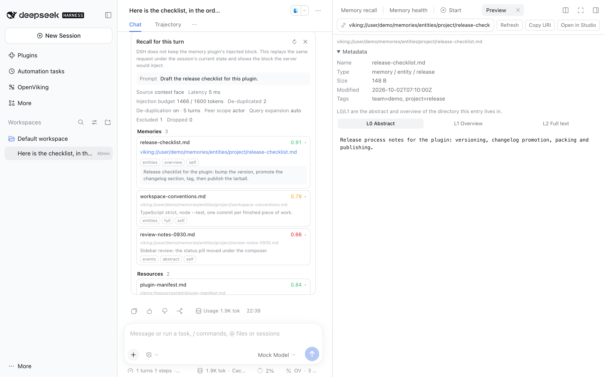
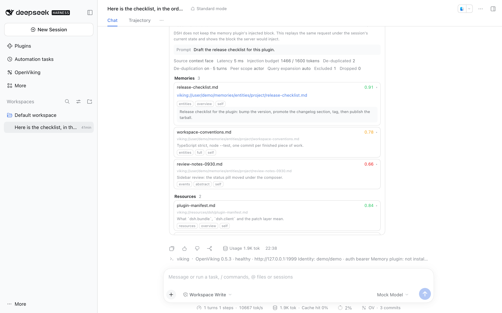
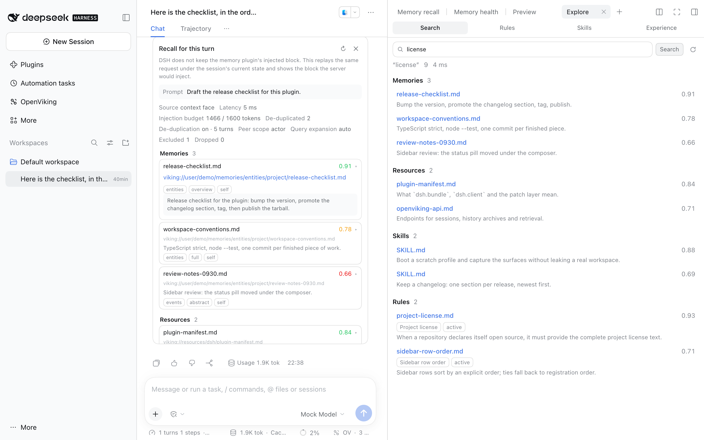
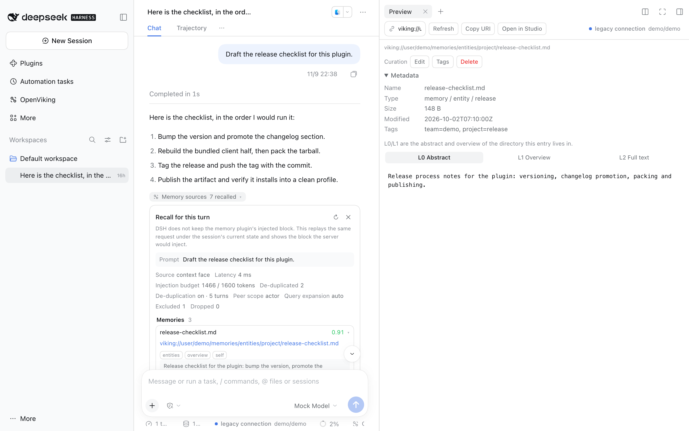
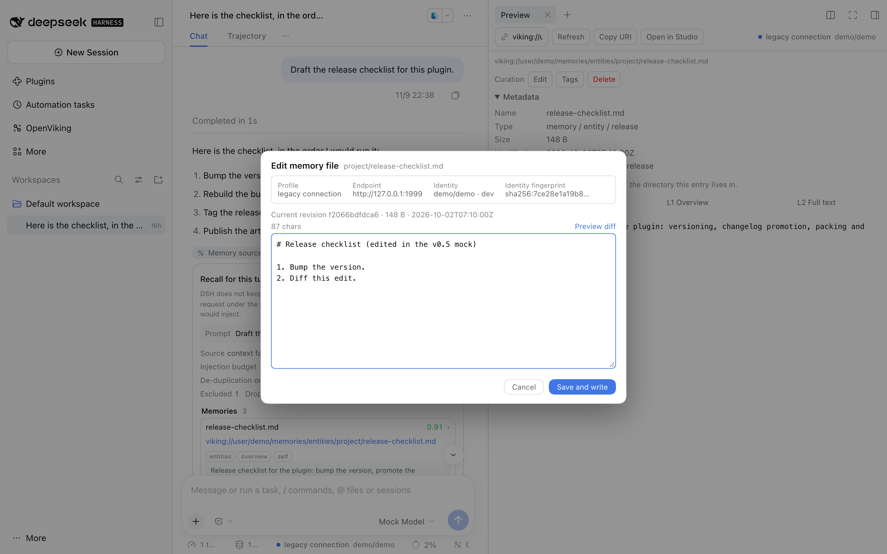
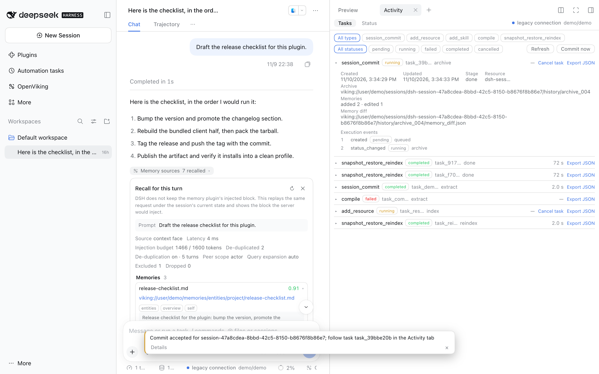
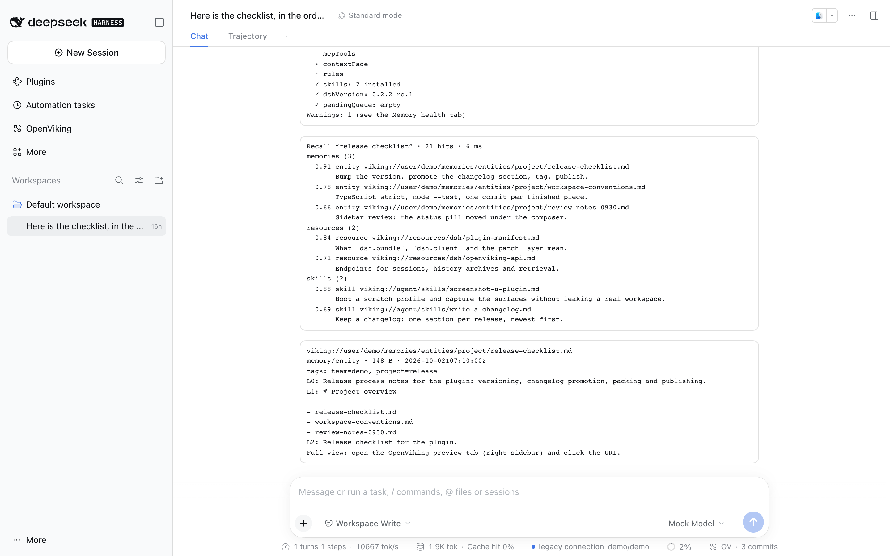
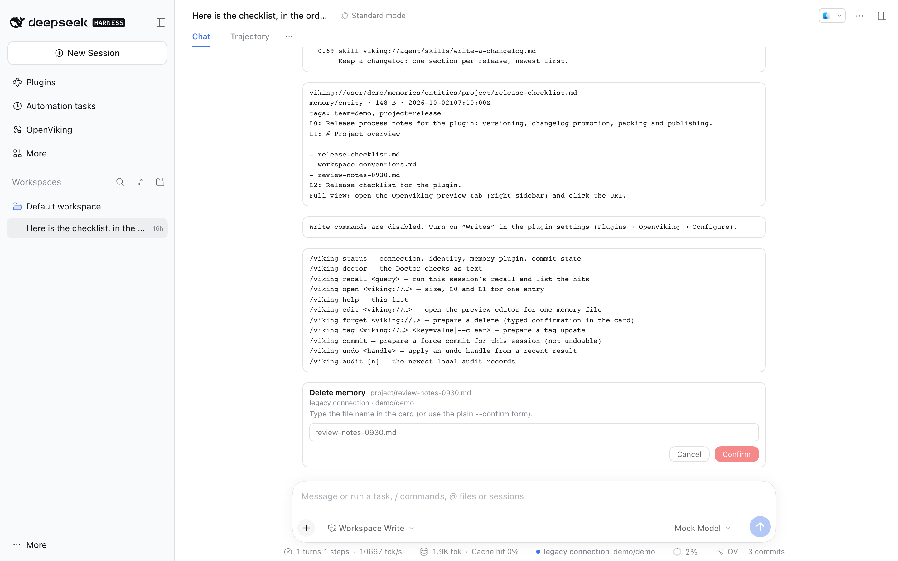
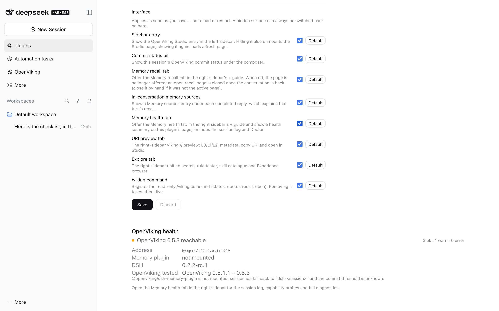

# dsh-openviking-enhance

English | [中文](README.zh.md)

**v0.3.0** · [Changelog](CHANGELOG.md) · [Roadmap](ROADMAP.md)

> The v0.4 Act, v0.5 Collaborate, v0.6 Trust-and-verify, v0.7 Native, v0.8
> Operate, v0.9 Multi-scope and v1.0 Native-complete changes below are under
> `Unreleased`; the version line and package stay at 0.3.0 until the release
> script promotes them (see “Release path for 1.0.0”).

Brings your local [OpenViking](https://docs.openviking.ai) memory server into the
DeepSeek Harness (DSH) Web GUI: a Studio panel in the left sidebar, a commit
status pill and diff browser under the message box, a per-turn explanation of
what the memory plugin retrieved, a Memory health tab that answers "why is this
memory session not working?", a `viking://` preview, a `/viking` command and an
Explore page that searches the library and explains the rules that constrain it.
v0.5 adds the collaboration layer on top: **opt-in** memory curation with typed
confirmations and snapshot undo, forced commits, a fifth *Activity* tab, and
named identity profiles with a persistent scope banner.

Nothing needs to be patched in DSH or in the OpenViking plugin — it mounts as an
ordinary DSH bundle.

## What you get

**Read your memory without leaving DSH.** A new row at the bottom of the left
sidebar opens a **native read cockpit**: an Overview, a lazy `viking://` Browse
tree with a preview pane, a paginated Sessions browser with per-archive diffs,
a bounded recent-Commits browser and a Stats view. The core reading tasks work
without the iframe; the OpenViking server's own Studio stays one explicit view
(and one "open in a new tab") away, and `showNativeViews: false` restores the
v0.6 Studio page exactly. Everything here is read-only.

**Multiple servers, one explicit scope (v0.9).** Named profiles stay the
credential/server unit; a scope is a profile plus an optional in-server identity
override (account/user/peer read selectors). The cockpit's scope chip opens a
first-class scope menu (servers grouped by endpoint, health/version/latency,
warnings, switch, refresh health, test connection); a persistent banner names the
active scope on every native view and right-sidebar tab. Switching is guarded
(refused while a curation/ops confirmation is pending; in-flight reads are
aborted and dropped; the cockpit returns to Overview and plugin sidebar pages
close), every plugin request carries the scope fingerprint, and the host refuses
a request for another scope with `scope-changed`. There is **no federated or
cross-server search**: every read goes to the active scope. A read-only **Access**
tab reports the server's ACL data for a selected `viking://resources/**` entry
with four explicit states (`available` / `denied-no-manage` / `only-resources` /
`unsupported`) and says plainly that the tested server builds have **no
sharing/invite API**. The plugin still never calls an admin/account/group
endpoint, never edits an ACL and never rebinds the official memory plugin's
pipeline (it warns, read-only, when the two connections differ).

### The native read cockpit (v0.7)

One sidebar row, one main panel, six internal views — no second shell seat:

| View | What it reads | Notes |
| --- | --- | --- |
| **Overview** | one composed host request: config, identity scope, health/version, memory totals, capabilities and the Studio frameability fact | default view; each part degrades independently |
| **Browse** | lazy `viking://` tree over the identity's roots (memories, peers, shared/personal resources, personal/agent skills, rules/session shortcuts) + a read-only preview pane | one `fs/ls` page (50 rows, 160-char abstracts, tags) per expanded directory, paged with the server cursor; directory counts read `N+` when more pages exist; an explicit "Show subtree" action is capped at 2 levels/100 nodes |
| **Sessions** | the sessions directory, 50/page, newest first | the server's session list has no pagination; detail reuses the bounded session log (state, pending tokens, tasks, archive timeline, per-archive diff) — **no transcript**, message bodies are never read |
| **Commits** | bounded recent fan-out: newest 8 sessions, pool 4, 10 s deadline, 30 s cache | there is no global commit history API; a partial answer says so ("stopped after N sessions at T ms") and Refresh retries. Never polled |
| **Stats** | the same REST console/observer/stats sources as the Activity tab, through the shared metric cards | Prometheus `/metrics` is never probed |
| **Studio** | the v0.6 iframe, unchanged | the explicit fallback; the host-side header probe explains an embedding refusal instead of the panel silently going blank |

- **Navigation is in-memory.** Back/Forward walk a bounded (20-entry) history;
  the panel reopens on Overview. There is no browser URL routing because DSH
  exposes no route API for main-panel selection.
- **Deep links never steal the main column.** Incidental `viking://` clicks keep
  opening the right-sidebar Preview tab. Explicit actions ("Open in cockpit" in
  the Preview tab such as the session pill's context) use
  `ctx.layout.selectPanel('openviking')`, capability-detected structurally; on an
  older DSH generation without that action the action falls back to the Preview
  tab (and the panel toolbar says so).
- **First-run checklist.** A read-only setup card appears in Overview and as a
  second section on the plugin's Plugins page: endpoint/health/identity/memory
  plugin/capabilities/suggested first step. "Run full check" reuses the Doctor;
  dismissal/completion is stored per DSH home in a 0600 local file (see privacy),
  writes are skipped while `showOnboarding` is off, and "Forget local setup state"
  deletes the file (the action is audited).
- **The right-sidebar tabs are unchanged.** Recall, Memory health, Preview,
  Explore and Activity stay the session-contextual surfaces; the cockpit is the
  global reading surface and links to them (Rules/Experience live in Explore).

**Per-session commit status.** OpenViking writes memory in *commits*: a session's
turns accumulate until a token threshold is reached (or the session ends), then
they are archived and the memories are extracted. The pill under the message box
tells you where the session you are looking at stands.

The pill follows the app's language (see *Notes*); in English it reads:

| Pill | Meaning |
| --- | --- |
| `OV · not committed` | Nothing from this session has been committed yet |
| `OV · 12.3k/20k` | Turns are accumulating towards the commit threshold |
| `OV · extracting…` | A commit is being archived and its memories extracted |
| `OV · 3 commits` | Three commits so far |
| `OV · extraction failed` | The newest commit was archived but its memories could not be extracted |
| `OV · cancelled` | The newest commit was cancelled before its memories were extracted |
| `OV · unavailable` | The local OpenViking server cannot be reached |

Click the pill for details:

- a **timeline** of the most recent 3 commits — when each happened, whether its
  extraction finished or failed, and how many memories it added, updated or
  deleted (the rest are one click away);
- clicking a commit opens a **diff browser**: filter by added, updated or
  deleted, expand any change to see its before/after text with a line diff, copy
  a `viking://` URI, or export the commit as JSON:

  
- any **failed extraction**, with the time, the server error and the task id
  while the task record is still retained, plus a copy-error control. Failures
  older than the newest commit stay listed there without changing the pill.

The pill and the panel read only. With `enableWrites` on (v0.5+), changes happen only through the curation dialog and write-command paths described above; nothing here writes.

**What this session retrieves.** The right sidebar gains a *Memory recall* tab: it shows what OpenViking pulls in for the session you are looking at
— the query it searched with (that session's most recent message, or one you type
yourself), every hit in each of its three sources (memories, resources, skills)
with its score — graded from red through orange to green — its file name, its kind
(`entity`, `event`, …) and its abstract. The full `viking://` path is on hover, and
opening a row loads that entry's whole text. The plan the server retrieved with is there
too. Open it from the right sidebar's `+`
guide; it is per session, like the column itself.


**Why did this turn use that memory?** Under every completed reply the
conversation gains a small *Memory sources* entry. Opening it replays that
turn's prompt against the server's context face and shows the query, every hit
with its score, category, `viking://` URI, read tier and provenance, the token
budget (used/max), quotas, tier counts, exclusions, cross-turn de-duplication,
the retrieval plan and the assembled injection block.

The card is explicit that it is a **replay**: DSH does not retain the memory
plugin's injected block, so claiming to show the historical injection would be
false. Servers without the context face fall back to the per-target search and
say so.


**Is this session being captured?** A second right-sidebar tab, *Memory health*,
answers the five questions that used to require guessing: nothing captured,
captured but not committed, extracting after a commit, extraction failed, or
writes queued locally. It shows messages, pending tokens and the threshold,
commits, last commit and last auto-commit, recent tasks, and a timestamped
activity timeline. It also reads the official plugin's local pending queue
(counts, types and times only — never payloads).

**Why is it not working?** The same tab carries the **Doctor**: endpoint,
health, server version, identity, the mounted memory plugin's version and
effective recall/capture/commit settings, where each connection value came from
(profile override, environment, `ovcli.conf`/`.local`, or default), and live
probes for the context face, rule search, skills, the model-visible
`mcp__openviking__*` tools, `fs/stat` and retrieval metrics. Every check points at
a likely fix, and the diagnostic JSON or
`curl /health` command is one click away. API keys are never included.


The plugin's own page under **Plugins** also gets a compact health summary, so
"is it working?" can be answered without opening a session.


The Studio panel, the sidebar row that opens it, and the commit pill below the composer.



**Open any `viking://` URI.** Every URI in the plugin's detail views is a link
now — the loaded recall-row detail, the explanation card, the commit diff rows,
and the Explore results. Clicking one opens the *Preview* tab in the right sidebar (or re-targets the preview that is
already open) with the entry's metadata — name, file or directory, context and
memory type, category, size, modified time, lock, tags — and the server's three
read tiers: L0 abstract, L1 overview and L2 full text, each with its availability
and truncation marker. L0/L1 are the directory-level sidecars OpenViking
generates, so a file's tiers describe the directory it lives in (the panel says
so); L2 is files-only and says that on a directory. Everything is plain text —
a memory body never becomes markup. Copy the URI or open the entry in Studio from
the panel, or paste a `viking://` path into its address bar.



**Ask from the composer.** `/viking status` prints the endpoint, health, server
version, identity, the mounted memory plugin, the DSH version and the current
session's commit state; `/viking doctor` prints the Doctor's checks; `/viking
recall <query>` runs this session's retrieval and lists the scored hits; `/viking
open <uri>` prints metadata and bounded L0/L1. These read verbs leave the library
untouched; v0.5 adds the write verbs below, behind `enableWrites`.
`enableCommands` turns the whole command off.



**Explore the whole library.** The right sidebar's new *Explore* tab has four
read-only segments. **Search** runs one query across memories, resources and
skills (plus rules) and groups the hits with scores and abstracts; any row opens
the preview. **Rules** lists the rules this OpenViking serves and carries a
read-only tester that shows why a rule applies — its requirement, `applies_when`,
exception, probability and body. **Skills** is the installed catalogue, each row
opening its `SKILL.md`. **Experience** shows trajectories and the outcome
distribution of the Agent Evolution experience files. Rules need OpenViking
**0.5.3+** and are capability-probed, so an older server shows an explicit
"not available" line instead of an error; Experience is normally empty rather
than broken. Search is semantic-only: the live server rejects keyword-mode
search, so there is no toggle.



**Curate a memory — opt-in.** Changing OpenViking data is off by default:
`enableWrites` must be turned on explicitly, and with it off the plugin remains
exactly the read-only viewer described above. When it is on, curatable memory
files gain an action bar in the Preview tab — **Edit**, **Tags**, **Delete** —
and the commit pill and Activity tab gain **Commit now** (both disabled while the
session was last observed under another scope).

- **Only memory bodies are curatable**, and only under
  `viking://user/<u>/memories/{entities,events,preferences}/…` (plus the visible
  peer equivalents). Directory sidecars, rules, session archives, resources,
  skills and the root `profile.md`/`identity.md`/`soul.md` are excluded on
  purpose.
- **Edit** shows the current revision (hash, size, modified time), a character
  count and an optional diff. Saving reads the file, takes a snapshot of that
  path, writes, verifies the read-back, then takes a post-write snapshot.
  OpenViking 0.5.3 has no compare-and-swap for content writes, so a concurrent
  change is caught by that verification and reported as a conflict to reload.
- **Delete** asks you to type the file name and says plainly that the server has
  no recycle bin. **Tags** replaces, appends to or clears the tag list
  (`key=value` grammar), and takes the same snapshot/undo path. Every
  snapshot-backed action snapshots and restores the containing directory — one
  scope for both halves, because file-level restore is unverified on the tested
  server builds.
- **Undo** is a toast action after the write: it builds a snapshot-restore dry
  run filtered to the paths the action touched, and asks for a second
  confirmation when the plan would also revert unrelated changes **or when a
  same-named file was rewritten after the action**. It fails closed when the
  pre-write snapshot is missing and is refused after an identity switch. There
  is no second copy of a memory body on disk.
- **Every attempt is audited**, including refused ones, in
  `${DSH_HOME:-~/.dsh}/state/dsh-openviking-enhance/audit.jsonl` (mode 0600,
  rotated at 1 MiB, two old files): time, action, URIs, identity fingerprint,
  request id, result and the undo handle — no memory bodies, tokens or secrets.



**Commit now — and what capture control cannot do.** *Commit now* asks the
server to archive the session's uncommitted messages and extract memories. It is
single-flight, shows pending tokens / live messages / commits first, always asks
for confirmation, runs asynchronously and can be followed in the Activity tab.
Extraction itself cannot be rolled back. The same panel shows the capture state
the official memory plugin reports (capture on, auto-commit, threshold), but
**pausing or resuming capture is not shipped**: the plugin exposes no runtime
API for it yet (`runtime.setCaptureEnabled(session, boolean)` would be the
upstream change). Failed extractions are diagnosed with the server error, the
archive URI and an exportable task, but there is **no retry button** — the
OpenViking builds tested here (0.5.1.1–0.5.3) have no retry endpoint.



**Activity: tasks, metrics and recent actions.** A fifth right-sidebar tab lists
background tasks with type/status filters and cursor paging; a task opens to its
execution events, a cooperative cancel (which does not roll back completed
writes) and a JSON export of the safe fields. Four independent metric cards cover
the server dashboard, the write queue, memory statistics and this session's
statistics, each degrading on its own. Recent audited actions are listed there
too. `/metrics` is never probed: it is disabled on most servers.



**Several servers, several identities.** Named profiles — label, endpoint, auth
mode, API key, account, user and peer — live in a plugin-owned
`${DSH_HOME:-~/.dsh}/state/dsh-openviking-enhance/profiles.json` (mode 0600), and
the profile editor sits in the same **Configure** form. The key is write-only: it
is never returned to the browser and never logged. An active profile wins over
the legacy `endpoint`/`apiKey`/`account`/`user` fields, the environment and
`ovcli.conf`; with no profile active the legacy values still work. A persistent
scope chip shows endpoint, auth mode, account, user, peer and an identity
fingerprint, and warns for remote endpoints; the write dialogs repeat the scope
regardless of the chip. Writes are refused when the identity is ambiguous, undo
is bound to the identity that performed the write, and switching identity while a
confirmation is pending is guarded — the UI blocks the switch, and if a settings
save races a pending token the host fails closed with `identity-changed`. In `dev`/`trusted` mode the plugin sends the
identity headers; in `api_key` mode the key itself determines the identity and no
headers are sent. ACL is shown as the v0.9 four-state read-only Access report (never as a guessed
"enabled/disabled"), with no
admin enumeration.



**Write commands from the composer.** `/viking forget <uri>`, `tag <uri> …` and
`commit` prepare an action and return a card in the transcript with
Confirm/Cancel (typed file name for delete, tag chips, commit warning). Clients
without the card get a two-line plain fallback naming `--confirm <token>`; the
token's prepared action is checked host-side **before** anything is written, so
confirming a delete with a tags token is refused instead of performing the tags
write. `edit` only opens the preview editor (its dialog prepares and confirms),
`undo <handle>` runs the dry-run plan and applies it immediately (an
extra-changes plan still needs the confirmation dialog), and `audit` is a pure
read. Dialog deletions require typing the file name; the command path uses the
single-use token as its confirmation. Confirm tokens are single-use, valid for
120 seconds and bound to the identity/action/target; at most 8 may be pending,
at most 3 **writes** per minute are allowed (enforced when the token executes,
so preparing several does not burst past it), and preparations take a real
snapshot, so they have their own quota of 10 per minute (cancelling does not
refund it). One write runs at a time; dismissing a dialog releases its pending
token, and denied attempts are audited.

## Host contract and compatibility

This is the host contract for the plugin: what it supports, how it installs,
what runs where, what it reads and writes, its limits, how it degrades, what it
does **not** do, and the privacy boundary. Dated evidence lives in
[`VERIFICATION.md`](VERIFICATION.md).

### Supported versions

| Component | Supported | Verified / notes |
| --- | --- | --- |
| DSH (reads) | `>=0.2.0-rc.2 <1.0.0-0 || >=0.2.1-rc.2 <0.2.2-0 || >=0.2.2-rc.1 <0.3.0-0` (`engines.dsh`; every pre-release line is upper-bounded below 1.0) | built and type-checked against 0.2.2-rc.1; verified on 0.2.0-rc.2, 0.2.1-rc.3/rc.5, 0.2.2-rc.1 |
| DSH (writes) | **0.2.2-rc.1+** | authenticated `ctx.connection.fetch`; older generations keep every read surface and disable writes with a stated reason |
| OpenViking | 0.5.1.1 – 0.5.3 tested | 0.5.2 unverified, 0.5.4 unprobed. Preview/search/skills/Experience on 0.5.1.1+ (Experience verified on 0.5.3); **Rules need 0.5.3+**; the context face is 0.5.3 |
| Official memory plugin | `@openviking/dsh-memory-plugin` (optional) | 0.5.32 verified on the maintainer's machine; its in-process state is read, not a published stable contract (see Known gaps) |
| Node | `^22.19.0 || >=24` (`engines.node`) | CI runs Node 22 |
| OS | Linux CI; macOS 15 verified manually; **Windows unverified** | no macOS/Windows CI automation in this release |

The tested OpenViking range this release claims is **OpenViking 0.5.1.1 – 0.5.3**
(0.5.2 unverified, 0.5.4 unprobed).

The DSH range is stated per pre-release line (`0.2.0` / `0.2.1` / `0.2.2`, each
with the upper bound below 1.0): npm-style semver will not admit `0.2.2-rc.1` to
a single comparator set anchored at `>=0.2.0-rc.2`, while DSH's own compatibility
check evaluates with pre-releases included. `engines.dsh` and the
`peerDependencies` range are the same string, so the manifest and the peer check
agree; each alternative is upper-bounded.

### Install / upgrade / uninstall

**CLI / web profile** (the npm-installed `dsh`):

```bash
# from npm
dsh plugin --profile web add dsh-openviking-enhance

# or a prebuilt tarball from the latest release / a local pack
dsh plugin --profile web add https://github.com/A2chitect/dsh-openviking-enhance/releases/latest/download/dsh-openviking-enhance.tgz
pnpm pack && dsh plugin --profile web add ./dsh-openviking-enhance-<version>.tgz

# remove
dsh plugin --profile web remove dsh-openviking-enhance
```

**Desktop app**: install from the Plugins page (**Add plugin** → package name or
tarball) or with the Desktop app's own bundled launcher. The npm-installed `dsh`
refuses the reserved `desktop` profile — that is the official DSH behaviour, not
a limitation of this plugin.

**Upgrade** = install the newer version, then restart the app. The *host* half
(`lib/index.js`) is loaded at startup, so a host change needs a restart; the
*client* half (`lib/client.js`) is fetched on page load, so a client-only change
applies after a window reload. **Uninstall** = remove the package, then restart;
the row, the routes and the composed client bundle are gone (verified by
`pnpm run verify:install`).

The client half is a prebuilt bundle: installing from a source checkout without
`pnpm pack` gives the shell nothing to load.

### Process model, inputs and outputs

- **In-process host plugin + browser bundle.** No daemons, no worker processes, no
  background timers beyond polling by a panel that is currently mounted.
- **No lifecycle hooks, no MCP proxy, no tools, no URI guard, no skill
  distribution** (those belong to the official memory plugin — see the N/A
  matrix below). One optional `/viking` command registers through `ctx.commands`.
- **Routes on the DSH web server**: read-only GETs plus three POSTs — the unified
  search and rule tester (read-only queries), and the plugin's own onboarding-state
  write, which persists one 0600 local JSON file and makes **zero** OpenViking
  calls. They answer loopback + same-origin requests only, carry a JSON body of at
  most 64 KiB, and never write OpenViking.
- **Mutations only through the authenticated `ctx.connection.fetch` transport**
  (DSH 0.2.2-rc.1+); there is deliberately **no loopback POST path that reaches
  OpenViking**. Session authentication is enforced by that DSH transport, not by
  this plugin, and a direct unauthenticated POST to any plugin route is a
  read-only query, a 404, or the local onboarding-state write below — never an
  OpenViking mutation (the smoke harness asserts 404 on every `/write/*` path).
- **Reads from the official plugin**: per-session runtime config/state, the
  pending-queue directory (file names/ages only, never payloads), capability
  memos, and server-produced commit/archive artifacts. It never writes them.
- **Writes**: only the plugin's own `profiles.json`, `audit.jsonl` and
  `onboarding.json` under `${DSH_HOME:-~/.dsh}/state/dsh-openviking-enhance/`,
  plus user-triggered curation requests sent to OpenViking. The onboarding state
  POST rides the same loopback/same-origin JSON guard as the read routes, not the
  authenticated mutation transport, because it is not an OpenViking mutation: it
  writes **only** the plugin's own 0600 `onboarding.json`, is clamped to the
  documented action vocabulary (`dismiss`/`reset`/`forget`/`complete-step`/
  `full-check`), and every action is recorded in the local audit trail.
- **Startup is non-blocking and contained**: an activation failure is logged and
  the entry provides nothing; it cannot take the profile down. OpenViking being
  down degrades route answers, never the host.

### Native read routes (v0.7)

All of them are loopback + same-origin GETs that never write, except the local
onboarding-state POST:

| Route | Contract |
| --- | --- |
| `GET /api/openviking-enhance/overview?fresh=0` | composed config + scope + metrics + plugin fact + Studio status + onboarding, per-part `available/error`, cached 5 s |
| `GET /api/openviking-enhance/browse/roots` | identity-resolved `viking://` roots (no listing) |
| `GET /api/openviking-enhance/browse?uri=&offset=&limit=` | one `fs/ls` page, 50 rows, 160-char abstracts, tags, server cursor; 404 = empty page + notice; non-allowlisted/internal scopes refused |
| `GET /api/openviking-enhance/browse/subtree?uri=&levels=&nodes=` | the explicit bounded `fs/tree` action (≤2 levels/≤100 nodes) |
| `GET /api/openviking-enhance/sessions?offset=&limit=` | paginated session-directory page (50/page, mtime-desc) with DSH/non-DSH kinds |
| `GET /api/openviking-enhance/recent-commits?limit=&fresh=0` | bounded fan-out (≤8 sessions, pool 4, 10 s deadline, 30 s cache) with `partial`/`limitedBy`/`progress` |
| `GET /api/openviking-enhance/studio-status?fresh=0` | credential-free header probe: `frameable` yes/no/unknown + reason, cached 60 s |
| `POST /api/openviking-enhance/onboarding/state` | `{action:'dismiss'|'reset'|'forget'|'complete-step'|'full-check', …}` → writes/deletes only the 0600 local `onboarding.json`, records the action in the local audit trail, zero OpenViking calls |

### Operational routes (v0.8 "Operate")

Read routes are loopback + same-origin GETs; the five actions ride the **same
authenticated `ctx.connection.fetch` transport** as v0.5 writes (POST only, JSON
≤64 KiB) and reuse the prepare → confirm → execute → verify → audit → undo
protocol. Loopback GETs for actions never exist.

| Route | Contract |
| --- | --- |
| `GET /api/openviking-enhance/snapshot-log?branch=main&limit=&paths=` | bounded commit history (20/page, cap 100); a fresh account's `git_ref` 404 is "no history yet", an absent route is "unavailable" |
| `GET /api/openviking-enhance/snapshot-show?ref=&path=` | commit metadata, or one bounded text preview (64 KiB cap; binary = metadata only) |
| `GET /api/openviking-enhance/snapshot-diff?path=&from=&to=` | one unified diff, display cap 200 000 chars; server size limits surface as "too large" |
| `GET /api/openviking-enhance/snapshot-diff-paths?paths=&from=&to=&offset=&limit=` | changed-path page (OpenViking 0.5.3+; absent route degrades to "not supported") |
| `GET /api/openviking-enhance/snapshot-versions?uri=&limit=&beforeVersion=` | compile-output file versions (0.5.3+, page 20); `NOT_COMPILE_MANAGED` is an explicit empty state |
| `GET /api/openviking-enhance/snapshot-ignore` | read-only `.ovgitignore` display |
| `GET /api/openviking-enhance/compile` | runtime capability + the 0.5.3 target registry (each degrades on its own 404) |
| `GET /api/openviking-enhance/compile-target` / `compile-operations` / `compile-operation` / `compile-outputs` / `compile-submission` | bounded operation/output/submission inspection; submission lookup is the idempotency-recovery read (never a retry) |
| `GET /api/openviking-enhance/observability?days=1..7&fresh=0` | observer cards + console token/context-commit series, cached 30 s, on demand; **`/metrics` is never requested** |
| `GET /api/openviking-enhance/pack/history` | metadata-only export rows from the local audit trail |
| `GET /api/openviking-enhance/task/evidence?taskId=` | bounded (512 KiB) JSON attachment: safe task fields/events + ≤20 local audit rows + ≤20 on-demand `/console/audit` request rows + build/identity |
| `GET /api/openviking-enhance/ops/download?token=` | one-time-token download of a host temp file (0600 under the plugin state dir, 64 MiB cap, deleted after download/expiry; the token is never audited) |
| `POST /api/openviking-enhance/ops/{prepare,execute,plan,undo,cancel}` | authenticated transport only; one discriminated `action`: `snapshot-create`, `snapshot-restore`, `compile-run`, `pack-export`, `file-version-restore` |

| Action | What it changes | Confirmation | Undo | Audit |
| --- | --- | --- | --- | --- |
| snapshot-create | one append-only commit | scope + message + paths, explicit confirm | **no** (commits cannot be deleted through the API) | `snapshot` (oid) |
| snapshot-restore | files under one directory, a new commit + reindex task | dry-run plan + real counts (also when the row list is capped) + typed directory leaf; extra-changes second confirm for undo. The scope may not be — or contain — the pipeline-owned `sessions` tree | forward restore to the pre-restore parent | `snapshot` (pre/post commit, task id) |
| compile-run | derived output files + reindex | explicit to/from/skill/instruction + host `Idempotency-Key`; no typed word (no user file is overwritten) | **no** (no rollback API); cancellation is cooperative | `compile` (task id + idempotency key) |
| pack-export | a local `.ovpack` download only | the active user's own tree (or `viking://resources`); include-vectors (default off), 64 MiB cap, one-time download. **The pack contains the full session transcripts of the active user** — treat it as sensitive | **no** | `pack` (bytes; no content) + `download` |
| file-version-restore | one compile-output file, a new version (CAS) | current/target version + typed file name | CAS restore of the pre-restore version (refused after a change) | `snapshot` (version ids) |

Undo is a safety action: it stays available if `enableOps` is switched off
after an action (the transport, identity and capability gates still apply), so
turning the switch off can never trap a user with a restored tree and no way
back.

Every action is additionally gated by the new **`enableOps`** switch (default
**false**; `enableWrites` stays curation-only), the authenticated transport, a
healthy probed identity, a runtime capability/role probe (never a version
comparison) and the **shared single-mutation gate** with curated writes. Tokens
are single-use, 120 s, identity-fingerprint-bound; ops are limited to 2 successful
executions and 6 preparations per minute. There is **no Retry button anywhere**:
the tested servers expose no task-retry API, and a compile can only be "re-run as
a new compile" (a new operation with a new Idempotency-Key). OVPack
**backup/import/restore are deliberately deferred** to a later release (they are
ROOT/ADMIN, account-wide, non-atomic and/or need a server temp-upload flow), as
are rules compile, compile config updates/embeddings/reindex, watches and session
snapshot restore.

### Multi-scope routes and switching (v0.9)

Read routes (loopback + same-origin fence, JSON envelopes):

| Route | Purpose |
| --- | --- |
| `GET /api/openviking-enhance/scopes?fresh=0` | the scope list: rows grouped by server (label, endpoint, probed auth mode, account/user/peer, health/version/latency, per-scope capability summary, stable warnings, active state), the identity-override rules, the active scope block and the advisory official-plugin facts. Cheap `/health` probes only (cached 10 s); **never** `/admin`. |
| `GET /api/openviking-enhance/session-scope?sessionId=` | the best-effort local session→scope record and the mismatch verdict for a DSH session (no bodies, no keys, no endpoint). |
| `GET /api/openviking-enhance/acl?uri=` | the read-only ACL report for one user-selected `viking://resources/**` URI, classified as `available` / `denied-no-manage` / `only-resources` / `unsupported`, plus the URI's visibility class. No mutation path. |

Switching: the v0.5 profile switch keeps its proven `ConfigForm.set('activeProfile')`
mechanism; the in-server identity override is the **local** mutation
`POST /api/openviking-enhance/scope/identity` on the authenticated transport
(it writes only `scope-state.json`, never OpenViking). Both are refused by the
client guard while any curation/ops confirmation, write or undo is pending or
executing, and the host refuses the identity route while the shared mutation gate
has unresolved tokens. In-flight reads are aborted and any response from the
previous scope is dropped; a slow host read that finishes after a switch answers
`409 scope-changed` instead of a stale payload. A profile switch persists the new
active profile in `scope-state.json` and **resets the identity overrides**.

Discovery routes: `/scope` and `/scopes` intentionally accept a request that
still names the previous scope key (the host may already have moved) and answer
with the current scope, labelled. This is how the client completes a switch
chain; every other read refuses a stale key with `scope-changed`. The
scope-changing mutations reply with the new scope payload, which the client adopts
directly: `POST /scope/identity` (identity override) returns the full scope; the
profile CRUD routes return the redacted profile list and the client re-reads
`/scope` afterwards (there is no scope payload in the profile CRUD response).

Isolation contract: every plugin request carries
`x-dsh-openviking-scope: <scope key>` (the secret-free `sha256:` identity
fingerprint over profile + endpoint + probed auth mode + effective
account/user/peer); the host compares it with the active key and refuses
mismatches with `scope-changed` before any work. Every response is labelled with
the active key. Caches are cleared on a switch (the approved simple fallback for
the per-scope policy: **clear all caches on a switch**, no scope set is retained),
capability matrices are per scope, ACL reports are cached per scope and dropped on switch,
and the page never offers an all-scopes search. The scope list's `/health`
probes run with bounded concurrency (4) under one overall deadline, so a desk of
unreachable profiles cannot stall the menu. A corrupt `scope-state.json` is kept
as-is at boot (falling back to the profiles header/legacy chain) and reported
through the scope warnings and the Doctor's config-source health — it is not
silently overwritten. The active profile cannot be deleted (the resolved scope,
not just the runtime form value, is checked), and every profile deletion
re-resolves a stale state pointer.

Session-scope write boundary: a DSH session observed under another identity shows
the mismatch banner; the host **also refuses** `/write/prepare` (and execute/undo)
for that session with the stable `session-scope-mismatch` code, so no cross-scope
write can happen even if a stale button were clicked. The mismatch tuple is the
profile id, the effective account/user/peer **and the endpoint** (so a legacy-mode
server change is detected too); the recorded identity is shown in the banner and a
same-profile "switch back" restores it in one action. That action sends only the
fields that actually differ and that the auth-mode rules allow — under `api_key`
(identity key-bound) a peer-only mismatch restores with the peer selector alone
instead of a request the host would refuse — and a refusal is shown in the banner
rather than swallowed. The Activity tab's "Commit now" follows the same
session-scope gate as the commit pill (a mismatched session shows the action as
disabled instead of relying on the host to refuse it).

Identity switching rules (F12 completion): `dev`/`trusted` profiles allow
account/user header overrides (trusted needs both; **the plugin never sets a role
header**); `api_key` is key-bound, so account/user are disabled with that reason
while the peer selector stays a read lens; `oidc`/`ldap` are out; an unreachable
server disables switching, and a switch additionally requires a **known-healthy**
probe. The two disabled states are distinct and recoverable: before the first probe
the overwrite fields are disabled with `scope-health-unprobed`, while a probed but
down server reports `profile-unhealthy`; reading `/scopes` awaits the (cheap,
cached) capability probe before computing the rules and the menu's "Refresh health"
refreshes both `/scopes` and `/scope`, so the documented refresh actually recovers.
An already-stored override still resolves before the probe.
The peer is **read-only**: it is sent as `X-OpenViking-Actor-Peer` only for
sessionless reads (browse, preview, ACL, sessions browser), while write
preparation reads and all mutations never send it (they use only the official
plugin's session actor peer, when one exists) — the exact split the v0.5 README
promised.

### Timeouts and limits

Every value below is exported from `src/shared/limits.ts`; `test/v06-docs.test.mjs`
parses this block out of both READMEs, so the documented contract cannot drift
from the code. Times are milliseconds; sizes are bytes unless marked.

<!-- contract:limits -->
| constant | value |
| --- | --- |
| DEFAULT_REQUEST_TIMEOUT_MS | 8000 |
| HEALTH_TIMEOUT_MS | 4000 |
| STATUS_TIMEOUT_MS | 5000 |
| FS_TIMEOUT_MS | 8000 |
| LIST_SEARCH_TIMEOUT_MS | 12000 |
| CONTEXT_SEARCH_TIMEOUT_MS | 20000 |
| RECALL_CONTENT_TIMEOUT_MS | 10000 |
| WRITE_TIMEOUT_MS | 20000 |
| SET_TAGS_TIMEOUT_MS | 10000 |
| SNAPSHOT_TIMEOUT_MS | 30000 |
| DOCTOR_CONTEXT_PROBE_TIMEOUT_MS | 10000 |
| DOCTOR_RULES_PROBE_TIMEOUT_MS | 8000 |
| DOCTOR_FS_PROBE_TIMEOUT_MS | 5000 |
| RULES_CAPABILITY_TTL_MS | 600000 |
| WRITE_TOKEN_TTL_MS | 120000 |
| WRITE_BODY_MAX_BYTES | 65536 |
| WRITE_CONTENT_MAX_CHARS | 65536 |
| RULE_LIST_DEADLINE_MS | 15000 |
| RULE_LIST_CONCURRENCY | 4 |
| PREVIEW_BODY_MAX_LINES | 400 |
| PREVIEW_BODY_MAX_LINES_RESPONSE | 1000 |
| PREVIEW_MAX_CHARS | 20000 |
| AUDIT_MAX_BYTES | 1048576 |
| AUDIT_MAX_LIMIT | 100 |
| AUDIT_KEEP_ROTATIONS | 2 |
| ACTIVITY_TASKS_MAX_LIMIT | 50 |
| BROWSE_PAGE_SIZE | 50 |
| BROWSE_ABSTRACT_MAX_CHARS | 160 |
| BROWSE_SUBTREE_MAX_LEVELS | 2 |
| BROWSE_SUBTREE_MAX_NODES | 100 |
| BROWSE_CACHE_TTL_MS | 15000 |
| BROWSE_CACHE_MAX_DIRECTORIES | 100 |
| SESSIONS_PAGE_SIZE | 50 |
| SESSION_LIST_CACHE_TTL_MS | 15000 |
| RECENT_COMMITS_SESSION_CAP | 8 |
| RECENT_COMMITS_CONCURRENCY | 4 |
| RECENT_COMMITS_DEADLINE_MS | 10000 |
| RECENT_COMMITS_CACHE_TTL_MS | 30000 |
| OVERVIEW_CACHE_TTL_MS | 5000 |
| STUDIO_STATUS_TIMEOUT_MS | 4000 |
| STUDIO_STATUS_TTL_MS | 60000 |
| NATIVE_HISTORY_MAX | 20 |
| OPS_TOKEN_TTL_MS | 120000 |
| OPS_MAX_PENDING | 8 |
| OPS_RATE_LIMIT | 2 |
| OPS_RATE_WINDOW_MS | 60000 |
| OPS_PREPARE_RATE_LIMIT | 6 |
| OPS_PREPARE_RATE_WINDOW_MS | 60000 |
| PACK_MAX_BYTES | 67108864 |
| PACK_CAPABILITY_TTL_MS | 600000 |
| PACK_DOWNLOAD_TTL_MS | 120000 |
| PACK_DOWNLOAD_MAX_ACTIVE | 2 |
| OPS_EXPORT_TIMEOUT_MS | 120000 |
| SNAPSHOT_LOG_PAGE | 20 |
| SNAPSHOT_LOG_MAX | 100 |
| SNAPSHOT_SHOW_MAX_BYTES | 65536 |
| SNAPSHOT_DIFF_MAX_CHARS | 200000 |
| SNAPSHOT_PATHS_MAX | 16 |
| SNAPSHOT_RESTORE_PLAN_PATHS | 50 |
| SNAPSHOT_DIFF_PATHS_PAGE | 100 |
| FILE_VERSIONS_PAGE | 20 |
| COMPILE_CONFIGS_MAX | 50 |
| COMPILE_FROM_MAX | 8 |
| COMPILE_SKILL_MAX_CHARS | 128 |
| COMPILE_INSTRUCTION_MAX_CHARS | 500 |
| COMPILE_OPERATIONS_PAGE | 20 |
| COMPILE_OUTPUTS_PAGE | 50 |
| OBSERVABILITY_CACHE_TTL_MS | 30000 |
| OBSERVABILITY_MAX_DAYS | 7 |
| TASK_EVIDENCE_MAX_BYTES | 524288 |
| SNAPSHOT_MESSAGE_MAX_CHARS | 200 |
| PACK_BODY_INACTIVITY_TIMEOUT_MS | 30000 |
| EVIDENCE_LOOKUP_DEADLINE_MS | 15000 |
| TASK_EVIDENCE_CORRELATION_MAX | 20 |
| SCOPE_STATE_VERSION | 1 |
| SCOPE_PROBE_TTL_MS | 10000 |
| SCOPE_PROBES_CONCURRENCY | 4 |
| SCOPE_PROBES_DEADLINE_MS | 8000 |
| SCOPE_SWITCH_COOLDOWN_MS | 1000 |
| SESSION_SCOPE_MAP_MAX | 64 |
| SCOPE_KEY_MAX_CHARS | 200 |
| ACL_URI_MAX_CHARS | 4096 |
| ACL_ENTRIES_MAX | 200 |
| SCOPE_HEALTH_TIMEOUT_MS | 4000 |
<!-- /contract:limits -->

The Rules-listing deadline is a **scheduling** deadline: requests already in
flight still finish under their own per-request timeouts, so a slow server can
push the wall clock to roughly the deadline plus one in-flight request. The
`progress` payload reports the actual elapsed time with every partial answer.

Also fixed: 25 entries per recall bucket / search request, 20 000 characters per
recall explanation and per loaded memory body, the Rules listing caps at 100
rules and 20 scenarios, and an L2 preview page returns at most 1 000 lines.

### Capability gates and degradation

| Feature | Probe / gate | Available when | Degradation |
| --- | --- | --- | --- |
| Read surfaces (preview, search, skills, session log, commits) | per-request HTTP result | OpenViking 0.5.1.1+ | explicit "unavailable" state, never an error pile |
| Context face (recall explanation) | one `search/search` with `mode:"context"` (Doctor only) | server supports the context face | falls back to per-target search; stats say "legacy path" |
| Rules list / rule tester | validation-only `POST rules/search {}` (no embedding/judge work) | OpenViking 0.5.3+ | one translated "needs 0.5.3+" line |
| Experience | `fs/ls` + `agent-evolution` endpoints | verified on 0.5.3 | empty state or "not available on this server" |
| Snapshot undo | `GET /snapshot/log` classification | route present (fresh accounts report "no history") | edit/delete disabled with the reason |
| Writes | `enableWrites` **and** authenticated transport **and** healthy probed identity | DSH 0.2.2-rc.1+ | read-only with a stated reason; every mutation fails closed |
| Operate actions (v0.8) | `enableOps` **and** authenticated transport **and** healthy probed identity **and** runtime capability/role probe **and** the shared single-mutation gate | DSH 0.2.2-rc.1+; capability answer decides (snapshot route, compile `configured && can_create`, pack export probe) | reads stay available; every action fails closed with `ops-disabled`/`compile-not-configured`/`pack-export-unavailable`/…; no Retry exists |
| Task evidence / Observability | per-request read, on demand | OpenViking 0.5.1.1+ (server request log only when `/console/audit` is reachable) | evidence warns `server-request-log-unavailable`; each observability card degrades alone; `/metrics` never probed |
| Activity tasks/metrics | `GET /tasks` and per-card probes | route present | per-card "not available"; `/metrics` is never probed |
| ACL / Access tab (v0.9) | one `GET /acl` for a user-selected `viking://resources/**` URI (follows the peer READ selector) | server route present **and** the identity has `manage` | four explicit states; 401/403 are `denied-no-manage` (auth vs manage detail kept distinct), 400 is `only-resources`, 404/5xx/network are `unsupported` with their own detail — a 403 never claims "ACL disabled" vs "missing manage"; a missing `acl_mode` is reported as unknown (never guessed "inherit"); no ACL edits exist |
| Scope switcher / scope list (v0.9) | cheap `/health` per configured profile + the active scope's capability probe | always | unreachable rows show the health error; the legacy connection is listed as a scope; missing profiles are warning rows, never auto-deleted |
| Identity override / session-scope guards (v0.9) | probed auth mode + **known-healthy** probe + the shared mutation gate; the session→scope map for writes | `dev`/`trusted` for account/user; peer for reads in most modes | disabled fields with a stated reason; a session last seen under another identity shows a mismatch banner, its recall/write actions are disabled, and the host refuses prepare/execute/undo with `session-scope-mismatch` until the user switches back |
| Native views | DSH `main`/`sidebar.panellist` slots (since v0.3) | always; `showNativeViews` (default true) | off = the exact v0.6 Studio page |
| Browse / Sessions / Commits | per-request HTTP result of `fs/ls` | OpenViking 0.5.1.1+ | per-view "unavailable on this server" state; a 404 directory is an empty page, not an error |
| Deep links (`ctx.layout.selectPanel`) | structural `get('layout')` + `typeof selectPanel === 'function'` | DSH 0.2.2-rc.1 (verified types) | Preview-tab fallback plus a toolbar note on older generations |
| Studio frameability | one anonymous, credential-free `GET endpoint + studioPath` header probe | any 2xx/XFO/CSP answer | host-side classification (yes/no/unknown + reason) never a browser guess |
| Onboarding card | composed overview + local state | always; `showOnboarding` (default true) | checks skip what is unavailable; the card hides without touching the state file |

### Not applicable (owned by the official memory plugin)

| Duty | Owner | This plugin |
| --- | --- | --- |
| Automatic recall, capture and commit | `@openviking/dsh-memory-plugin` | explains, diagnoses and (opt-in) forces a commit; it never replaces the pipeline |
| Lifecycle hooks, MCP proxy/tools, URI guard, skill distribution | official plugin / server | not present; no tools are exposed to the model |
| Pending-queue writes, retries, recovery | official plugin | read-only diagnosis (file names/ages only) |
| Capture pause/resume, archive retry | upstream API absent in the tested builds | explicitly not shipped, and said so where the state is shown |
| OVPack backup/import/restore | server (ROOT/ADMIN, account-wide) | v0.8 ships **export only**; backup/import/restore are deliberately deferred with their reasons shown in the Packs tab |
| Task retry | no API exists in the tested builds | "re-run as new compile" only (a new operation); the Tasks tab says so |
| Compile config update, embeddings, content reindex, rules compile, watches, session snapshot restore | server/CLI or later releases | not exposed; reads may still inspect compile configs/operations/outputs |
| Sharing / invites / share links | no API exists in the tested server builds | never invented: the Access tab shows the visibility classification + ACL report and states explicitly that there is no sharing API |
| Account/user/group/key administration and enumeration | server `/api/v1/admin/*` (ROOT/ADMIN, key-only) | **never called** in any mode; identity choices come from local profiles only (tests assert zero `/admin` requests) |
| ACL grant/revoke/edit | admin operations (`/acl/grant`, `/acl/revoke`) | not exposed; the Access tab is read-only |
| Federated / cross-server search, all-scope dashboards, parallel scope queries | no federation API exists | not shipped; every request targets the active endpoint and out-of-scope result URIs are dropped with a warning |
| OIDC/LDAP interactive login, remote TLS/proxy configuration | external IdP / deployment | not modelled; the scope menu shows the auth mode and a cleartext/non-loopback warning instead |
| Automatic official-memory-plugin reconfiguration or "rebind session to scope" | `@openviking/dsh-memory-plugin` owns its pipeline | never done; the plugin can only warn (read-only, allowlisted, secret-free projection) when the two connections differ |

### Data, privacy and the security boundary

- **Local first.** The plugin talks only to the configured OpenViking endpoint
  (loopback by default) and has **no telemetry** and no other outbound calls.
  A remote endpoint is allowed but the scope chip warns about it.
- **The read routes are loopback-only, and loopback is not a user boundary.**
  The fence checks the socket, the `Host` header, same-origin headers and the
  request shape, but any local process can still `curl` these reads on a
  multi-user machine. Mutations never use them: they ride the framework-
  authenticated `connection.fetch` transport.
- **Native reads are plain fenced GETs; Studio is still the server's own UI in an
  iframe.** The cockpit never proxies or re-renders Studio: it reads documented
  `viking://` routes through the same loopback/same-origin fence as every other
  route. If the server refuses framing (`X-Frame-Options`/CSP frame-ancestors) a
  host-side header probe reports that reason and offers open-in-new-tab; the panel
  never guesses from the browser (a blocked cross-origin frame exposes no error to
  the parent).
- **Credentials, in order of preference:** `~/.openviking/ovcli.conf`, the
  `OPENVIKING_*` environment variables, or a named profile in the plugin's own
  `profiles.json`. The legacy `apiKey` config field is declared
  `role('secret')` to the settings layer but storing it writes the plaintext key
  into your profile patch — treat it as a last resort. `profiles.json` is the
  secret store of record (mode 0600) and is not backed up or shipped by the
  plugin; keys are never logged and never included in Doctor/diagnostics.
- **No conversation or memory bodies in logs.** The local audit file records
  action/identity/URI/result, never bodies. The smoke harness is redacted by
  default (`SMOKE_VERBOSE=1` is the explicit local-only escape hatch).
- **What the plugin persists:** `profiles.json` (0600), `audit.jsonl` (0600,
  rotated at 1 MiB, two rotations kept), `onboarding.json` (0600, atomic),
  `scope-state.json` (0600, atomic) and `session-scopes.json` (0600, atomic,
  bounded 64 LRU entries), all under
  `${DSH_HOME:-~/.dsh}/state/dsh-openviking-enhance/`. `onboarding.json` holds only
  check ids/status timestamps and last-check counts — never an endpoint, account,
  user, key, peer, memory URI or memory body. Its `lastOpenedAt` is written only while the `showOnboarding` switch is on
  (turning the checklist off stops the writes); "Forget local setup state" on the
  Plugins-page Setup card deletes the file completely, and the action is recorded
  in the local audit trail. `scope-state.json` holds the active
  profile id and the optional account/user/peer read overrides — **no endpoint and
  no key**. `session-scopes.json` maps a DSH session id to the label/hash of the
  scope that last observed it plus the endpoint it was observed at (needed so a
  legacy-mode server change is detected) — no bodies, no keys; pre-v0.9-review
  files without an endpoint are tolerated (`null` = unknown, never a mismatch
  driver), it is best-effort local state and a missing record means "unknown",
  never "matches". The scope key
  is a hash and safe to display/audit; credentials never appear in any scope
  payload, audit entry or evidence document.
- **The official plugin's connection is advisory only.** v0.9 reads an
  allowlisted, secret-free projection (`baseUrl` host, account, user, peer,
  auth-mode hint) of the mounted official memory plugin to warn when
  "conversation memories are captured on server A while the cockpit views server
  B". The API key and the raw config object are never read out, copied or
  serialised; the projection fails open to "official plugin connection: unknown",
  and this plugin never rewrites the official plugin's credentials.
- **ACL principals are server-side identity data.** They are shown only for the
  user-selected resource in the Access tab, bounded (`ACL_ENTRIES_MAX`), cached in
  memory per scope only, and never written to the audit file, evidence or logs.
- **Binary/download exception, stated.** The one-time OVPack download and the
  task-evidence attachment are raw streams: they carry the current scope label as
  a response header, but they cannot answer a JSON `scope-changed` envelope
  mid-stream. The pack token is identity-fingerprint-bound and the broker closes
  on any switch, so a stale download cannot be served; the evidence attachment
  carries the identity block in its body.
- **The scope layer is not a security boundary.** Scope keys, banners and
  per-scope caches stop *this plugin* from mixing scopes; the server's auth/ACL
  remains the real boundary. Two profiles pointing at the same endpoint+identity
  are different labels for the same data, and a misconfigured server is not fixed
  by a banner.

### What the plugin sends (and what it costs)

"Read-only" does **not** mean "free": some read actions make the server do real
work. The full-window actions and their cost:

| Action | Server work |
| --- | --- |
| Preview, recall list, session log, skills catalogue, Experience lists | cheap `fs`/`content` reads |
| Memory recall explanation | one context-face search (embedding plus the server's query-expansion/rewrite stages) |
| Explore search (default) | one `search/search` list call over memories/resources/skills (embedding) |
| Explore search — **include rules** opt-in | additionally `rules/search`: scenario vector recall; a configured Rule judge model adds a model call per judgment |
| Rule tester **Run** | the same `rules/search` cost (the button says so) |
| Activity tab while visible | `tasks`/metrics polling; **no polling when the tab is hidden** |
| Writes, forced commit | user-triggered only, one confirmed action at a time |
| Native Overview (first paint) | one composed request: config health + capability probe + four metric reads + a cached Studio header probe; cached 5 s |
| Browse expand | one `fs/ls` page: 50 entries, 160-char abstracts, tags; cached 15 s (LRU 100); in-flight reads are aborted on refresh, view change and unmount |
| Browse "Show subtree" | one `fs/tree` call capped at 2 levels/100 nodes — explicit button only |
| Sessions list | one `fs/ls` page of 50 session directories, cached 15 s (one page key; `fresh=1` bypasses); detail = the existing bounded session log on selection only (no polling) |
| Commits view | up to 8 sessions × 3–4 cheap reads, pool 4, 10 s deadline, cached 30 s, never polled |
| Stats view | the same REST metrics reads as the Activity tab; explicit Refresh |
| Onboarding "Run full check" | the existing Doctor probe, user-triggered only |

Opening the Rules list does **not** spend a rule search: the capability gate is a
validation-only `POST rules/search {}` (rejected by the server's body validation
before any recall/judge work) and the list itself is bounded file reads (15 s
total deadline, concurrency 4, 100-rule/20-scenario caps, partial results kept
with a "showing N of up to M" line).

### OVPack download handling (v0.8)

An exported `.ovpack` is written to a **0600 temp file** under the plugin state
directory (the directory is 0700), streamed to the browser through a
**single-use token** that lives 120 s, and deleted after the one download, on
expiry, on the next history/export sweep, or on plugin unload (startup sweeps orphans too). Temp filenames carry the owning pid, so a
second plugin instance sharing the same `DSH_HOME/state` tree keeps its own
live downloads; only dead-owner and aged legacy files are swept. The audit records the URI, byte count and request id only — never
the content or the token. The export is capped at 64 MiB and a body that stalls
for 30 s (or exceeds the overall export deadline) is aborted so a slow server
cannot hold the shared mutation gate.

**A pack exported from `viking://user/<me>` contains the full session text**
(`messages.jsonl` and archived sessions) in addition to memories, so it is
sensitive user data by definition: the plugin refuses the bare `viking://user`
root and another identity's tree, and the UI says to delete the file when done.

### Known gaps

- The official plugin's in-process config/state object is **not a published
  stable upstream contract**; a major version of it may change the shape. This
  plugin degrades to "unknown/skipped" rather than guessing.
- Compatibility is verified for the listed DSH/OpenViking generations only;
  0.5.4 is unprobed and Windows is unverified.
- Writes need DSH 0.2.2-rc.1+; older generations are read-only by design.
- Repository compatibility is CI (Linux) + manual macOS; the Desktop carrier is
  installed and exercised manually, not in CI.
- **Older-DSH deep links degrade to the Preview tab.** Main-panel switching needs
  `ctx.layout.selectPanel` (verified on 0.2.2-rc.1); generations without it keep
  every read surface but cannot be driven to the cockpit programmatically.
- **No global commit history.** Archives live per session and task records are
  pruned, so Commits is the bounded newest-8-session list; older records are one
  click away in the session detail.
- **No transcript reader.** A session's `messages.jsonl` is never read: sessions
  show counts/markers/diffs and Studio remains the transcript reader.
- **No navigation persistence and no browser Back.** The in-panel history is
  in-memory by design; DSH exposes no URL routing for main-panel selection.
- This plugin is **community-maintained, not an official OpenViking project**.

## Native completeness (v1.0)

v1.0 is the completion release: the core memory flow now runs **entirely inside
DSH without opening the Studio iframe**. Studio stays registered as one explicit
view because it is the server's own full UI and hosts advanced operations — it is
the documented fallback, not a required step. The ledger below is the audit;
[`ACCEPTANCE.md`](ACCEPTANCE.md) maps every claim to evidence and records what is
still unverified.

### F1–F14 ledger

| # | Core task | Native surface | Shipped in | Studio needed? |
| --- | --- | --- | --- | --- |
| F1 | Why was this recalled / not recalled | Per-turn "memory sources" row + Memory recall tab (query, hits, scores, context stats, plan, budget, dedup) + `/viking recall` | v0.3 | no |
| F2 | What did this commit change | Commit pill, timeline, per-commit memory diff, failed-extraction detail, session/commits views | v0.3–v0.7 | no |
| F3 | Is this session captured; why did it fail | Memory health tab + session-log route and Sessions detail (five states, next action) | v0.3, v0.7 | no |
| F4 | Why no injection/tools/connection; versions; copyable JSON | Memory health tab + Plugins-page summary: Doctor with config-source health, build/UA/traceId, scope compatibility | v0.3–v0.9 | no |
| F5 | What is inside this `viking://` URI | Preview tab (L0/L1/L2, paging) + native Browse preview pane + deep links from every rendered URI | v0.4, v0.6, v0.7 | no |
| F6 | `/viking` commands | `ctx.commands` + command card; read commands plus confirmed write verbs | v0.3–v0.5 | no |
| F7 | Search everything | Explore tab: unified search over memories/resources/skills with click-through, rules an explicit opt-in | v0.4, v0.6 | no |
| F8 | Rules / skills / Experience centre | Explore tab: deadline-safe rules list, rule tester, skills catalogue, Experience browse; Browse shortcut rows | v0.4, v0.6, v0.7, v1.0 links | no |
| F9 | Curate memory with confirmation and undo | Preview action bar + dialogs + `/viking` write verbs; `enableWrites` default off, identity-bound tokens, audit | v0.5 | no |
| F10 | Capture/commit control | Force commit, capture state, failed-archive diagnosis are native; **pause/resume and archive retry are not shipped** (no upstream API) | v0.5, v0.6 | no (non-goal) |
| F11 | Tasks, failures, usage | Activity tab (tasks/cancel/export + metrics), Stats, Tasks/Observability in the cockpit | v0.5, v0.7, v0.8 | no |
| F12 | Multi-identity / scope / sharing | Named profiles, scope chip, first-class scope switcher with guards, read-only ACL/visibility view; no admin enumeration or sharing UI | v0.5, v0.9 | no |
| F13 | Compile / snapshot / OVPack | Operate group: snapshot read/create/restore (dry-run, typed confirmation, undo), compile read/trigger/monitor, pack export, task/evidence views. **Backup/import/restore, compile config, rules compile and watchers are not shipped** (documented upstream reasons) | v0.8 | no for shipped scope; Studio/CLI for deferred ops |
| F14 | First-run onboarding and native UI | Onboarding card + setup section; native cockpit by default with Studio as an internal fallback view | v0.7 | no |

### What remains Studio/CLI-only (and why)

| Studio/CLI-only | Why it is not native | Upstream dependency |
| --- | --- | --- |
| Conversation transcript reading | privacy/size: raw `messages.jsonl` is unbounded and contains conversation bodies | paginated, consent-aware transcript API |
| OVPack backup / import / restore | ROOT/ADMIN, account-wide, non-atomic temp-upload flow | admin/scope-safe backup design |
| Compile config/target editing, schedules | server-config write semantics | compile registry API + safety design |
| Rules compile/pause, `content/reindex`, compile embeddings | admin/advanced operations | product decision / future release |
| Watches (resource-watch controls) | unrelated subsystem; not task retry | server/CLI tooling |
| ACL edits, account/user/group management, sharing/invite | admin APIs; no sharing API in the tested builds; no enumeration by design | upstream admin/sharing APIs |
| Resource upload/edit, snapshot ignore edits, admin/privacy config | advanced Studio/admin operations | server contracts + safety design |
| Capture pause/resume, archive retry | **upstream APIs absent** in the tested builds | official-plugin runtime API / server retry route |

### Studio-off core-flow walkthrough

Reproducible read-only script (also the evidence set in `VERIFICATION.md` and
`ACCEPTANCE.md`): clean DSH profile, OpenViking reachable, `showNativeViews` on,
Studio never opened.

1. Open the OpenViking row → **Overview** loads (1 click).
2. Hover/click a completed turn's **memory sources** row → recall explanation
   opens in the transcript (2 clicks from the message).
3. Composer **commit pill** → timeline → pick the latest commit → memory diff
   (2 clicks).
4. Memory health tab → session state, next action and the **Doctor** (2 clicks).
5. Click any `viking://` URI in the recall/diff → **preview** tab opens with
   L0/L1/L2 (1 click); "Show more" pages a large body.
6. `/viking status`, `/viking doctor`, `/viking recall`, `/viking open <uri>`
   from the composer (1 action each).
7. Explore → **Search** a term (1 click + typing); tick "include rules (server
   cost)" to add the rules bucket.
8. Explore → **Rules**: list, then Run the rule tester (2 clicks); Skills and
   Experience are adjacent segments.
9. Browse: expand a directory, select a file, read the preview (2 clicks).
10. Activity: tasks, detail/events, export JSON; cancel a running task (2 clicks).
11. Scope chip → scope menu: switch profile/identity, watch the banner and each
    view relabel (2 clicks); the Access view shows the ACL state read-only.
12. On a disposable profile with `enableWrites`/`enableOps` on: edit + undo a
    memory, force a commit, view snapshot history and export a pack (confirm
    dialogs on every step).

Acceptance: **no step opens Studio**; every unavailable step shows its localized
degraded state and recovery action; if the Studio frameability probe reports
`blocked`, the walkthrough still passes (that is the fallback case).

### Final compatibility and evidence matrix

Status legend: **L** = verified live in this project; **CI** = verified in CI;
**M** = manual maintainer evidence; **D** = documented/probed in code, not
live-verified here; **U** = unverified (never claimed).

| Area | Supported / tested | Status |
| --- | --- | --- |
| DSH reads | `>=0.2.0-rc.2 <1.0.0-0` per pre-release line (`engines.dsh` = peer range) | CI typecheck/build on 0.2.2-rc.1; M on 0.2.0-rc.2, 0.2.1-rc.3/rc.5, 0.2.2-rc.1 |
| DSH writes / ops | 0.2.2-rc.1+ (`ctx.connection.fetch`) | CI install-verify on 0.2.2-rc.1; older generations read-only with a stated reason |
| DSH deep links (`ctx.layout.selectPanel`) | 0.2.2-rc.1 | M; older generations fall back to the preview tab |
| DSH identity overrides | 0.2.2-rc.1+ transport; profile switches also work on older generations | D/test; disabled with a stated reason on older generations |
| Node | `^22.19.0 || >=24` | CI Node 22; local v22.22.3 |
| OS | Linux CI; macOS 15 M; **Windows U** | no Windows runner or claim |
| Desktop carrier | DSH Desktop app, Plugins-page install | M visual/read-only; **desktop write parity U** |
| OpenViking | **0.5.1.1 – 0.5.3 tested**; 0.5.2 U; 0.5.4 U | core reads/sessions/commits/tasks/stats 0.5.1.1+; Rules, compile registry, snapshot versions/diff-paths 0.5.3+; pack export 0.5.1.1+ |
| OpenViking auth modes | `dev` L; `trusted`/`api_key` D; oidc/ldap U | headers/key rules are implemented and documented; only dev is live-verified here |
| Official memory plugin | `@openviking/dsh-memory-plugin@0.5.32` M | its in-process state is read defensively, never a stable contract |
| React peer | `^18.2.0` provided by the shell | D |
| Runtime dependencies | none first-party; bundled MIT `schemastery`/`cosmokit`; MIT DSH styling values | CI tarball + independence gate + `THIRD_PARTY_NOTICES` |
| Studio (iframe) | server's own `/studio/`, framing header probe + new-tab fallback | L: 0.5.3 sends no X-Frame-Options/CSP (2026-11-10); may change upstream — fallback documented |

### Accessibility (WCAG 2.2 AA-aligned, plugin widgets)

v1.0 aligns the plugin's own interaction surfaces — not the DSH shell chrome —
with WCAG 2.2 AA expectations, verified by DOM/component assertions plus a manual
keyboard/VoiceOver/zoom/contrast checklist (no browser automation; that evidence
limitation is recorded in `ACCEPTANCE.md` and no automated conformance claim is
made).

- **Trees**: Browse rows are a real ARIA tree — roving tabindex, Up/Down/Home/End
  movement, Right/Left expand-collapse-enter-leave, Enter/Space select,
  `aria-level`, `aria-selected`, `aria-expanded`, `aria-busy`.
- **Tabs**: cockpit/Explore/Activity/Browse/Stats/Operate/Preview tab strips are
  `tablist`/`tab`/`tabpanel` with `aria-labelledby` (only the active panel is
  mounted, so the tabs intentionally carry no dangling `aria-controls`),
  Arrow/Home/End selection that skips unavailable preview tiers, and roving
  tabindex.
- **Dialogs**: write/ops/undo dialogs trap Tab inside the modal and restore focus
  to the opener; cancel-first default focus; `role="dialog"` + `aria-modal`.
- **Live regions**: toasts use `aria-live` (assertive for errors, polite for
  outcomes), host warnings keep their native `<details>` disclosure with a polite
  count announcement, errors are `role="alert"`.
- **Scope menu**: the trigger announces `aria-haspopup`/`aria-expanded`; the scope
  choices are a labelled `menu` of `menuitem` rows with Arrow/Home/End traversal;
  Escape closes and restores focus. The surrounding panel stays a dialog because
  it also contains the identity-editor form fields.
- **Visibility and motion**: `:focus-visible` ring on every plugin control,
  `prefers-reduced-motion` disables transitions/animations, toolbars wrap and
  dialogs scroll at 200% zoom.
- **Status without colour**: state is always text/icon plus colour; status dots
  are decorative.
- **Limitations**: NVDA/Windows and macOS VoiceOver are manual checklists
  (Windows U); the automated suite covers structure and keyboard policy, not
  rendered focus movement.

### Bilingual parity

EN and ZH dictionaries are kept key-for-key equal by `test/locale.test.mjs`; v1.0
adds a render-level audit (`test/v10-locale-audit.test.mjs`) that renders the
major surfaces in both languages and fails on a raw locale key or hardcoded
English copy. Dates and counts use `Intl` for the active language (e.g. task
timestamps); byte sizes stay deterministic. README/README.zh chapters, the F1–F14
ledger and the compatibility matrix are mirrored row for row, and both are
asserted by `test/v10-docs.test.mjs`. **Known limitation:** `/viking` command
output is English — the host half has no access to the app locale and DSH renders
command results as plain text. This is documented, not claimed as bilingual; a
zh-CN walkthrough is part of the manual acceptance checklist.

### Request and performance budgets

| Budget | Value | Enforced by |
| --- | --- | --- |
| Initial cockpit paint | one composed `/overview` host request, cached 5 s, single-flight; no polling on paint | `test/v10-performance.test.mjs` (counting parts, TTL, concurrency) |
| Browse | 1 request per expanded page (50 rows); prompt/abstract caps; explicit subtree action ≤2 levels/100 nodes | browse limits + route tests |
| Recent commits | ≤8 sessions, 4 in flight, 10 s deadline, 30 s cache; never polled | commits constants + route tests |
| Polling | only a mounted, visible surface; a hidden document creates **no timer at all** (asserted with a fake clock, not just by reading the policy); an open running task polls at 2 s, the health log at 15 s while visible | `startScheduledPoll` in `poll-policy.ts` + `test/v10-performance.test.mjs` |
| Cancellation | view/scope/refresh/unmount aborts in-flight reads; stale answers are dropped by generation/scope key | v0.7/v0.9 tests |
| Payload bounds | preview 400 lines/page (1 000 max, 20 000 chars display), evidence 512 KiB, pack 64 MiB, task events 64×32 KiB | limits + route tests |
| First-paint timing | **not instrumented** (no benchmark/browser dependency) — manual observation only, recorded as a limitation | `ACCEPTANCE.md` limitations |

### Degraded states and error copy

Every host code that can reach a surface now has localized copy in both
languages: one wording pattern (state + reason + recovery action), with the
`notice.<code>` / `wcode.<code>` dictionaries as the single carrier and a test
that scans the host sources and fails when a code has no translation. The
documented failure matrix covers server unreachable, older server missing a
route, partial data (rules/commits deadlines), unsupported capabilities,
disabled switches, identity/scope problems, config-source health and empty
data. Server-provided English detail text is the final fallback only when no
code is known — shown verbatim rather than hidden.

### Decisions and version policy

[`DECISIONS.md`](DECISIONS.md) records the two final decisions: **the package is
MIT and every upstream-coupled behaviour is an independently implemented
contract** (no AGPL expression; the CI independence gate keeps it true; the
upstream licence ambiguity is documented, with re-write/relicense escalation if
ever needed), and **API stability = tested range + runtime capability probes +
graceful degradation**, not an upstream stability promise. The plugin package
follows semver for its own config/routes/commands/behaviour; the upstream
compatibility range is a tested matrix that moves by deliberate contract updates.
[`ACCEPTANCE.md`](ACCEPTANCE.md) holds the goal→evidence map, verdict taxonomy and
human sign-off.

### Release path for 1.0.0

The v0.4–v0.9 PRs are stacked and **unreleased** (`package.json` still says
0.3.0). If they merge without per-version tags, the documented fallback applies:
the whole `## Unreleased` block (v0.4–v1.0) is promoted into **one `1.0.0`
section**, the README version lines move to `v1.0.0`, and the tag-CI upgrade leg
keeps `--upgrade-from 0.3.0` for this tag (then moves to `1.0.0` for the next
release). Both the primary per-version path and this fallback are documented in
[`RELEASING.md`](RELEASING.md); the release script itself is unchanged and stops
at the local tag (publishing is a human 2FA step). Hotfix/rollback: never move or
retag `v1.0.0`; cut `1.0.1` for regressions and record the incident.

## Configuration

Everything has a sensible default — a standard local setup needs no configuration
at all. To change something, open **Plugins** in the sidebar, pick this plugin, and
use **Configure** on its row: the form carries the fields below, a **check**
button that probes the address before you save, and a *default* button per field
that clears the override instead of writing an empty value.

The same settings can still be written by hand in your profile's patch file
(`~/.dsh/profiles/<profile>/cordis.patch.yml`; `web` for the CLI, `desktop` for the Desktop app), under the row `openviking-enhance`:

```yaml
- id: openviking-enhance
  name: 'dsh-openviking-enhance'
  config:
    endpoint: http://127.0.0.1:1933
```

| Field | Default | Meaning |
| --- | --- | --- |
| `endpoint` | from `~/.openviking/ovcli.conf`, else `http://127.0.0.1:1933` | OpenViking base URL |
| `apiKey` | from `ovcli.conf` | Last resort only if the server requires authentication: saving this field stores the plaintext key in your profile patch. Prefer `ovcli.conf`, the `OPENVIKING_*` environment variables or a named profile |
| `account` / `user` | `default` / `default` | Identity the panel reads under |
| `studioPath` | `/studio/` | Where Studio is served on that origin |
| `cacheTtlMs` | `2500` | How long a status answer is reused |
| `recallCacheTtlMs` | `15000` | How long one retrieval answer is reused |
| `showSidebarEntry` | `true` | Interface switch: the OpenViking entry in the left sidebar |
| `showCommitStatus` | `true` | Interface switch: the commit status pill under the message box |
| `showRecallPanel` | `true` | Interface switch: the Memory recall tab in the right sidebar |
| `showRecallExplain` | `true` | Interface switch: the per-turn Memory sources entry in the conversation |
| `showHealthPanel` | `true` | Interface switch: the Memory health tab and the Plugins-page health summary |
| `showPreview` | `true` | Interface switch: the `viking://` preview tab in the right sidebar |
| `showExplore` | `true` | Interface switch: the Explore tab (search, rules, skills, Experience) |
| `enableCommands` | `true` | Host switch: the `/viking` command (read and write verbs) |
| `enableWrites` | `false` | Opt-in: curation (edit/delete/tags), forced commits and the write commands |
| `enableOps` | `false` | v0.8 opt-in: snapshot create/restore, compile trigger, OVPack export, file-version restore (all confirmation-gated; `enableWrites` stays curation-only) |
| `enableActivity` | `true` | Interface switch: the Activity tab (tasks, metrics, recent actions) |
| `showScopeBanner` | `true` | Interface switch: the persistent scope chip; write dialogs repeat the scope regardless |
| `showScopeSwitcher` | `true` | Interface switch (v0.9): the cockpit scope menu/switcher; off hides only the menu — the banner keeps its own switch and dialog/evidence scope blocks are never hidden |
| `showNativeViews` | `true` | Interface switch: the native read cockpit (Overview/Browse/Sessions/Commits/Stats). Off = the v0.6 Studio iframe page |
| `showOnboarding` | `true` | Interface switch: the first-run checklist (Overview card + Plugins-page Setup card); off hides the cards without clearing local state |
| `activeProfile` | `''` | Named credential/scope profile to use; empty = the legacy connection fields |



The **interface switches** control the surfaces independently. They
take effect as soon as you save — the GUI mounts or unmounts the surface without
a reload or a restart. The **Configure** form itself is never hidden, so a
surface switched off can always be switched back on there. Hiding the sidebar
entry also unmounts the Studio page (it loads fresh when shown again), and hiding
the recall tab closes an open recall page as soon as the conversation is back
on screen — a page that is open in a background pane has to be closed by hand,
because the harness exposes no way to enumerate tabs. The two v0.4 tabs behave
the same way, as does the Activity tab. `enableCommands`, `enableWrites` and
`activeProfile` are read by the host half, so they apply on the next plugin apply
(a save that reloads the plugin, or a restart) and immediately where the Loader
emits its volatile-config update; an older Loader without that event falls back to
the next apply. They are not applied by mounting anything.

**Profiles and secrets.** The profile editor on the same form writes
`${DSH_HOME:-~/.dsh}/state/dsh-openviking-enhance/profiles.json` with mode 0600;
API keys in it are write-only from the UI's point of view. The legacy fields
above keep working when no profile is active. The local audit file lives in the
same directory.

## Troubleshooting

**No OpenViking row in the sidebar, or no pill under the message box.**
First check the plugin's own switches (Plugins → this plugin → **Configure** →
*Interface*): a surface may be switched off, and the switches are independent.
Otherwise the client half is served as a file and picked up on page load. Reload
the window (⌘R). If it is still missing, restart the app.

**I hid the OpenViking row / pill / recall tab / explanation / health tab / preview / Explore tab and want it back.**
Open **Plugins** → *dsh-openviking-enhance* → **Configure** on its row and switch
it back on, then save. That form is always available, even with every
surface hidden.

**The curation controls are missing or say writes are off.**
`enableWrites` is off by default; turn it on in **Configure**. Writes also need
DSH 0.2.2-rc.1+ (the authenticated fetch transport) and a resolvable identity: if
no profile is active the legacy fields/`ovcli.conf` decide, and when the server
reports no auth mode the plugin refuses with an "identity ambiguous" reason.
Reads keep working in all of those cases.

**Undo is unavailable, or the undo plan mentions files I did not edit.**
Undo only exists for the write window of the current plugin session and the
identity that performed the write. Snapshot restore is directory-scoped, so the
dry-run plan can include sibling paths; the dialog then asks for a second
confirmation before applying. It also asks when the file was rewritten after the
action (a same-named file is not silently rolled back).

**Commit now did nothing / a forced commit failed.**
One commit is allowed in flight per profile and the plugin does not retry. A
"skipped" result means there were no uncommitted messages. Failed extractions
show the server error and the archive; the plugin cannot retry them because the
tested server builds expose no retry endpoint.

**`/viking` is not recognised.**
The command is registered by the host half and can be switched off with
`enableCommands` in the plugin's **Configure** form. A saved change is applied on
the next plugin apply (a save that reloads the plugin, or a restart), or
immediately when the Loader emits its volatile-config update; an older Loader
without that event falls back to the next apply. If the form already shows it on,
restart DSH once — the host half is loaded at startup.

**The Rules segment says the server has no rule list, or rule search fails.**
Rules are an OpenViking **0.5.3+** feature. On 0.5.1.1/0.5.2 the segment says so
explicitly. On 0.5.3 an empty rule library is normal (nothing has been compiled
yet) and still shows the tester.

**The preview shows "This tier has not been generated yet".**
OpenViking writes L0/L1 sidecars lazily (per directory and during compile), so a
fresh or never-compiled directory legitimately has placeholder text. L2 (the
stored file body) never uses the sidecar mechanism.

**The panel says it cannot reach OpenViking.**
Start the server and check it directly: `curl http://127.0.0.1:1933/health`. The
panel shows the address it tried, which helps when `endpoint` is not the default.

**The pill says extraction failed.**
The commit was archived but OpenViking could not turn it into memories — those
memories are not in your library. Click the pill for the server's own error; it is
usually a problem with the extraction model configured in `~/.openviking/ov.conf`.

**No memories appear in a reply, or a recall is empty.**
Open *Memory health* → *Doctor*: it distinguishes an unreachable server, a missing
or disabled memory plugin, recall/capture being off, an unknown commit threshold,
a legacy server without the context face, and a local write queue. Then open the
*Memory recall* tab and search the same prompt to see the server's own ranking.

**The pill shows a token count instead of a commit count.**
`@openviking/dsh-memory-plugin` is not installed, so the commit threshold is
unknown. Commits themselves still work; only the progress denominator is missing.

**The timeline shows only 3 commits.**
That is the default. Click *show all*.

**There is no recall or Memory health tab in the right sidebar.**
The tabs are reached through that column's own `+` guide, and they only exist
after a window reload (the client half is a file the page loads). If DSH is older
than 0.2.0-rc.2 it has no right sidebar to contribute to: the rows are skipped and
the Studio panel and the pill keep working.

**I changed the code and nothing happened.**
The two halves reload differently: the client half after a window reload, the host
half only after an app restart.

## Notes

- **The plugin's own text follows the app's language.** It ships Chinese and
  English and reads the locale DSH sets, so switching the app's language switches
  this plugin's copy too; anything else falls back to English.
- OpenViking cleans up its commit task records over time, so the failure list
  covers recent commits only. The archives themselves are permanent.
- The plugin's internal read routes answer loopback requests only; their fence
  checks the socket, the `Host` header and same-origin headers, and an
  `Origin`-less local `curl` is deliberately admitted. The only POST routes reach
  read-only search and rule-tester queries and require a JSON body of at most
  64 KiB. Mutations never use these routes: they go through the framework-
  authenticated `connection.fetch` service.
- **Read-only by default, writes opt-in.** v0.4 and the read side of v0.5 never
  change OpenViking data. With `enableWrites` on, the only writes are the
  curation, force-commit and write-command paths described above; each one is
  confirmed, verified after the write, snapshot-undoable (except extraction and
  force commit, which the server cannot roll back) and audited locally. The only
  data that leaves the machine is the OpenViking request itself — including to a
  remote endpoint when an active profile points elsewhere.
- **Writes need DSH 0.2.2-rc.1+.** They ride the framework-authenticated
  `ctx.connection.fetch` service; the plugin never exposes a loopback POST write
  route (the smoke harness asserts every mutation path answers 404 there). Who
  may call those routes is decided by the DSH connection transport's own session
  authentication — the plugin enforces confirmation tokens, identity binding and
  audit, but not the network-level authentication.
- **The profile "test connection" control is not a general URL prober.** It
  sends no credentials and only reads `/health`; it refuses non-`http(s)`,
  link-local/metadata (`169.254.0.0/16`, cloud metadata names,
  `fd00:ec2::254`, IPv6 link-local `fe80::/10` and IPv4-mapped IPv6 forms),
  unspecified, broadcast and multicast targets. Loopback and
  LAN addresses stay allowed on purpose (a private OpenViking server is a
  supported deployment); if a remote profile's test is refused, save it and read
  the scope/health instead.
- **Capture pause/resume and archive retry are not shipped.** The official
  memory plugin exposes no runtime pause API, and the tested OpenViking builds
  expose no archive-retry endpoint; the plugin says so instead of faking them.
- Tested range: OpenViking 0.5.1.1–0.5.3 (0.5.2 unverified, 0.5.4 unprobed), DSH
  0.2.0-rc.2+ for reads and 0.2.2-rc.1 for writes. The desktop carrier's write
  parity is documented as verified in the web profile; treat desktop writes as
  unproven until exercised there.
- Undo restores from snapshots; it is not a body backup, so it is gone when the
  snapshot is pruned or the plugin session ends. Force commit has no undo: the
  extraction it triggers cannot be rolled back.
- `/viking` output is short English plain text: the host half has no access to
  the app's locale, and the GUI renders command results without Markdown.
- Rules are an OpenViking 0.5.3+ feature; on 0.5.1.1/0.5.2 the Rules segment
  says so. Unified search is semantic-only because the live backend rejects
  keyword mode.
- The screenshots in `assets/` were captured against the stand-in server in
  `scripts/screenshot-fixture.mjs` (since v0.4 it serves the new read endpoints,
  and since v0.5 it simulates the write paths statefully) and a mock model, with
  a light theme at a 1440×900 viewport. The `v0*-before-*` images are the v0.4
  branch head (unreleased at capture time) in the same DSH 0.2.2 web profile; no
  real memory data or account is involved.

## Development

```bash
pnpm install
pnpm run build      # lib/index.js (host) + lib/client.js (browser)
pnpm test           # typecheck, packaging contract, unit tests, smoke harnesses
pnpm run watch      # rebuild on change
```

The smoke harness prints the commit timeline without needing the GUI (redacted by
default — set `SMOKE_VERBOSE=1` for raw local detail), and skips the live-data part
when OpenViking is not running (`SMOKE_REQUIRE_SERVER=1` makes that a failure
instead). `pnpm run verify:install` runs the clean-profile install/boot/reinstall/
uninstall check; the excerpts the independent recall contract is written from are
tracked in [CONTRACT.md](CONTRACT.md), the behaviour inventory behind the
independence claim is in [PROVENANCE.md](PROVENANCE.md), the licence/API-stability
decision is [DECISIONS.md](DECISIONS.md), the v1.0 goal→evidence map and human
sign-off are [ACCEPTANCE.md](ACCEPTANCE.md), and the code comments explain how the
pieces fit together.

The version lives in `package.json` and is tagged `vX.Y.Z` in git; while it is `0.x`
the internals may still change. See [CHANGELOG.md](CHANGELOG.md) for what each
release contains, and [RELEASING.md](RELEASING.md) for the release steps and the
GUI acceptance checklist — that one is a maintainer document, Chinese only.
