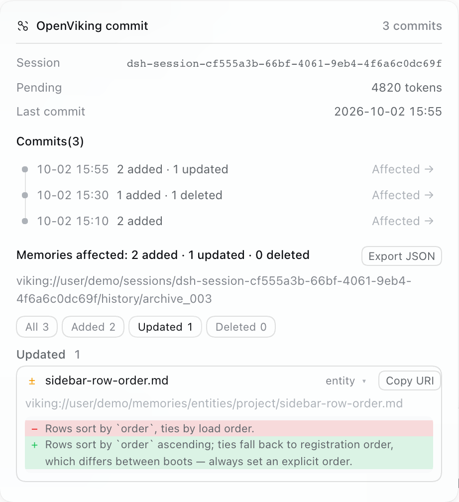
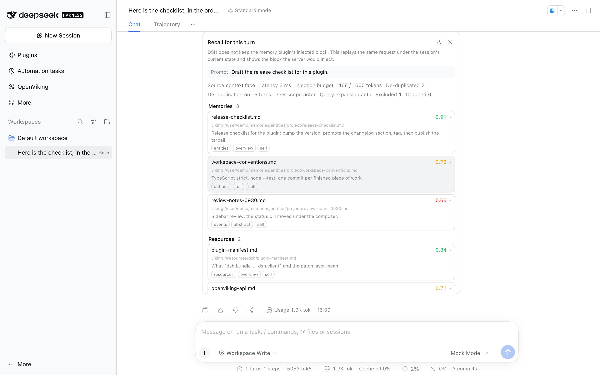
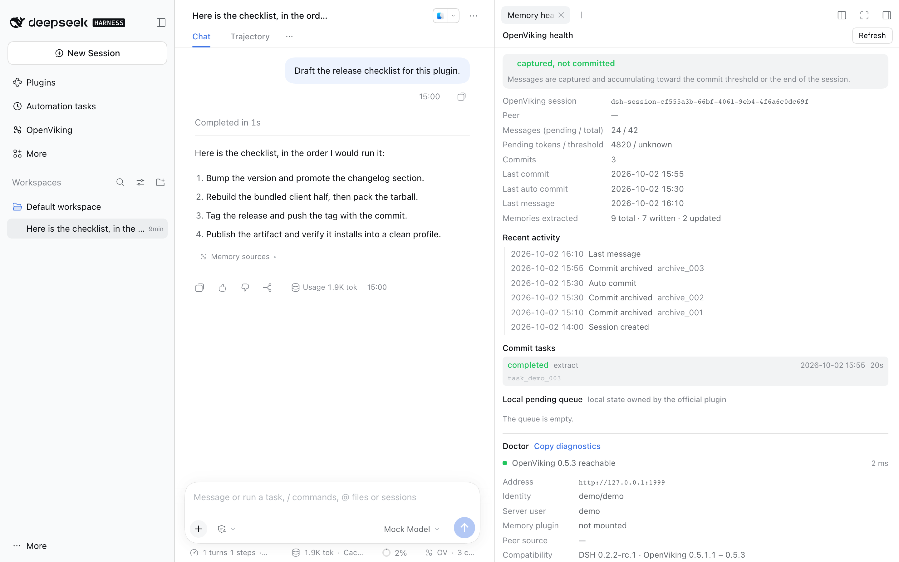
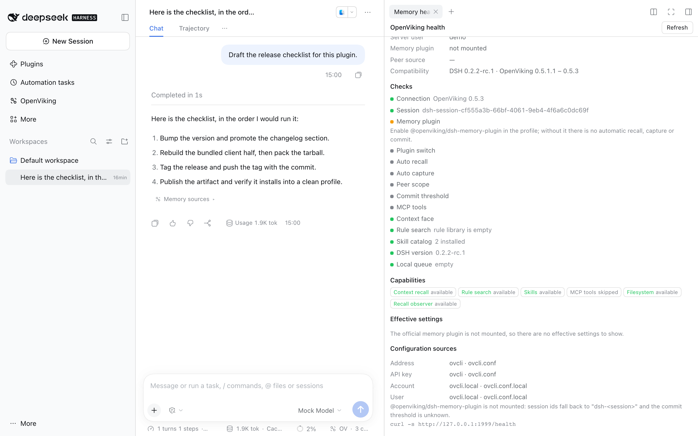
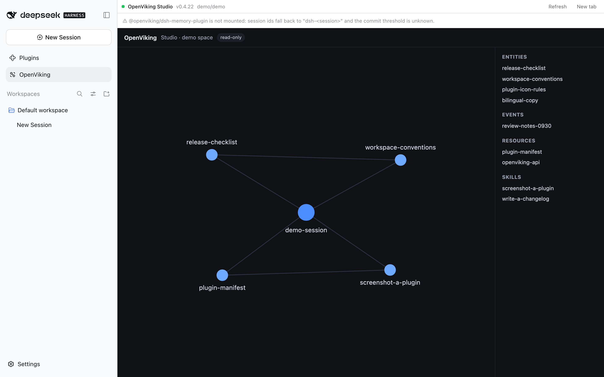
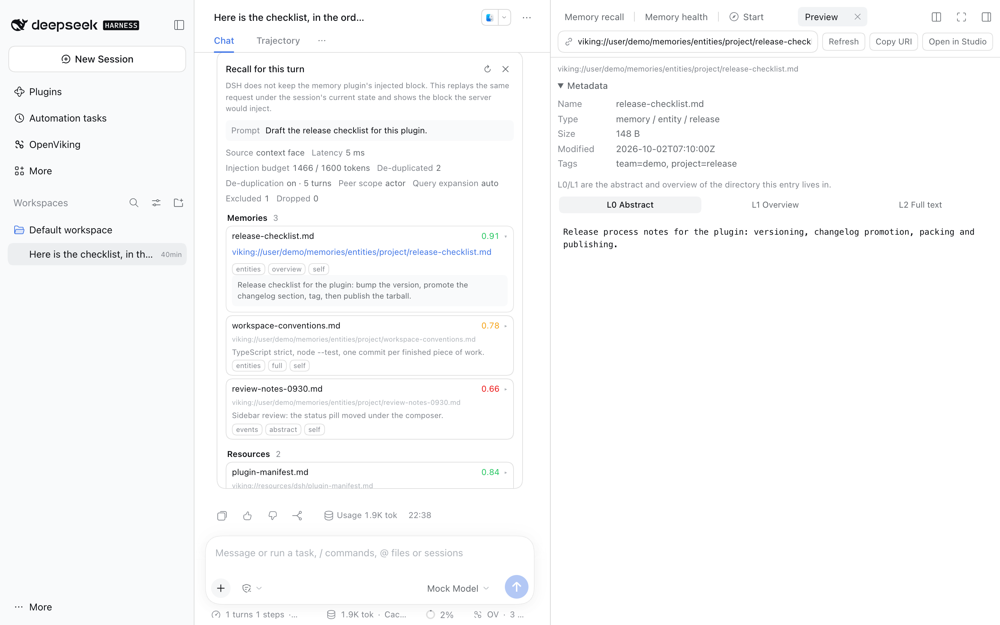
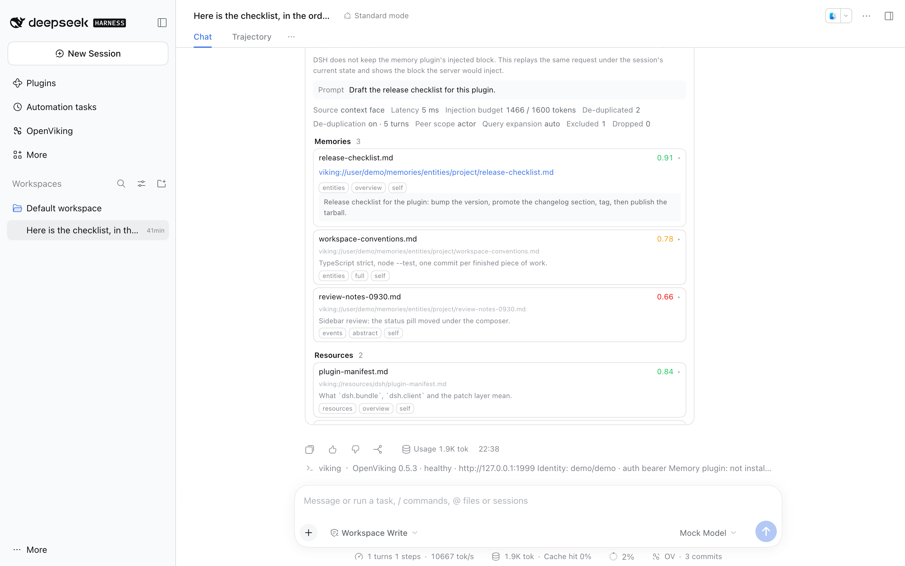
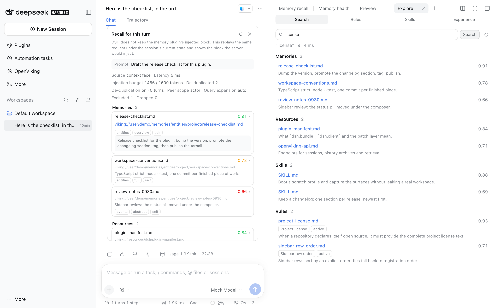
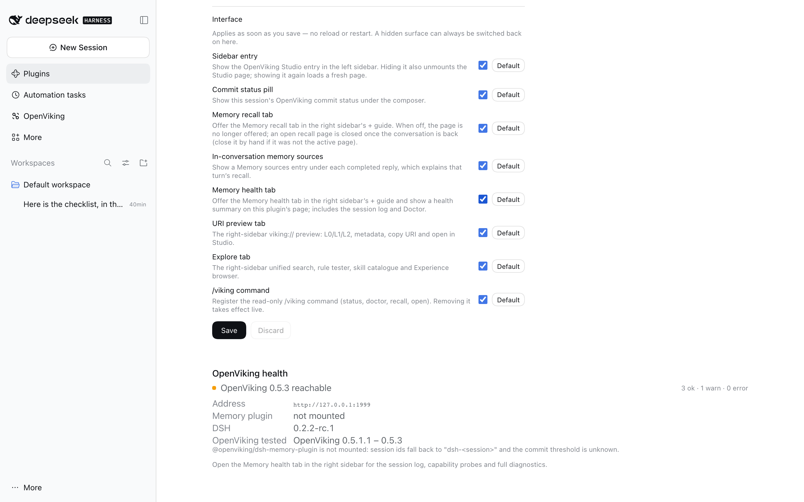

# dsh-openviking-enhance

[English](README.md) | 中文

**v0.3.0** · [更新记录](CHANGELOG.md) · [路线图](ROADMAP.md)

> 下面的 v0.4 Act 功能位于 `Unreleased`；版本行与包版本保持 0.3.0，直到
> `pnpm run release 0.4.0` 将其提升并打标签。

把本地 [OpenViking](https://docs.openviking.ai) 记忆服务接进 DeepSeek Harness
（DSH）的 Web 界面：左侧边栏的 OpenViking Studio 面板、输入框下方的 commit 状态
胶囊与 diff 浏览器、每条回复下方的召回解释、回答「记忆为什么没生效」的
「记忆健康」页，以及 v0.4 新增的 `viking://` 预览、只读 `/viking` 命令和探索页
（统一搜索 + 规则/技能/Experience 浏览）。

不需要给 DSH 或 OpenViking 插件打补丁——它就是一个普通的 DSH bundle。

## 功能

**在 DSH 里用 OpenViking Studio。** 左侧边栏最后一行点开，主区域直接加载
OpenViking 服务自带的 Studio 界面，浏览记忆、会话、检索都不用离开 DSH 或另开浏览器。

**每个会话的 commit 状态。** OpenViking 是按「提交（commit）」写入记忆的：会话的
对话轮次累积到 token 阈值（或会话结束）时归档一次，并抽取其中的记忆。输入框下方的
胶囊告诉你当前会话处在哪一步：

| 胶囊 | 含义 |
| --- | --- |
| `OV · 未提交` | 本会话还没有内容被提交 |
| `OV · 12.3k/20k` | 正在累积，接近提交阈值 |
| `OV · 抽取中…` | 正在归档并抽取记忆 |
| `OV · 3 次提交` | 已提交 3 次 |
| `OV · 抽取失败` | 最新一次提交已归档，但记忆抽取失败 |
| `OV · 已取消` | 最新一次提交在抽取记忆前被取消 |
| `OV · 不可用` | 连不上本地 OpenViking 服务 |

点开胶囊可以看到：

- **时间线**：最近 3 次提交分别发生在什么时候、抽取成功还是失败、各新增/更新/删除了多少条记忆
  （其余一次点击展开）；
- 点某一次提交，打开 **diff 浏览器**：按新增/更新/删除筛选，展开任意变更看前后文本与
  行级 diff，复制 `viking://` URI，或把整次提交导出为 JSON：

  
- **抽取失败**的时间、服务端错误和 task id（task 记录尚未被清理时），并可复制错误。
  比最新提交更早的失败仍会列在这里，但不会改变胶囊状态。

面板和胶囊都只读——本插件不会向 OpenViking 提交、写入或删除任何东西。

**这个会话检索到了什么。** 右侧边栏多一个「记忆召回」tab：显示当前会话会被
OpenViking 拉进上下文的记忆——检索用的那句话（默认是本会话最近一次提问，也可以自己输入）、
三个来源（记忆 / 资源 / 技能）里每条命中的分数（按高低从红到橙到绿分级）、文件名、
类型（`entity`、`event` 等）与摘要——完整 `viking://` 路径悬停可见，点开任意一条可看全文——
以及服务端给出的检索计划。从右侧边栏的 `+` 引导页打开，和该栏本身一样是按会话的。



**这条回复为什么用了那条记忆？** 每条已完成的回复下方多一个「记忆来源」入口。展开后
会用该轮提问重放服务端的上下文接口，显示提问、每条命中的分数、类别、`viking://` URI、
读取层级与来源、token 预算（已用/上限）、配额、层级统计、排除、跨轮去重、检索计划，
以及服务端组装的注入块。

卡片会明确说明这是**重放**：DSH 不保留记忆插件注入的原始文本，假装展示历史注入只会
误导人。没有上下文接口的旧服务端会退回逐目标检索，并说明原因。



**这个会话到底被捕获了吗？** 右侧边栏新增「记忆健康」页，区分五种过去只能靠猜的状态：
没有捕获到消息、已捕获但未提交、提交后抽取中、抽取失败、写入正在本地排队（以及正常的
已提交）。页面显示消息数、待提交 token 与阈值、提交次数、最近提交/自动提交、最近任务，
以及一条带时间戳的活动时间线。它还会读取官方插件本地 pending 队列的**数量、类型和时间**
（绝不读取 payload）。

**为什么记忆不生效？** 同一个页面里有 **Doctor**：地址、健康、服务端版本、身份、
已挂载记忆插件的版本与生效的召回/捕获/提交设置、每个连接字段来自哪一层（profile 覆盖、
环境变量、`ovcli.conf`/`.local` 或默认值），以及上下文接口、规则检索、技能、`fs/stat`
与召回观测的真实探测，并列出模型可见的 `mcp__openviking__*` 工具。每项检查都会指出
可能的修复方向，诊断 JSON 和 `curl /health`
一键复制；API key 不会出现在任何报告里。



插件在 **Plugins** 页的详情里也有一块健康摘要，不打开会话就能先回答「它正常吗」。



Studio 面板、打开它的侧边栏行，以及输入框下方的提交状态胶囊。



**点开任意 `viking://` 路径。** 插件各详情视图里的每个 URI 现在都是链接——已加载的
召回行详情、召回解释卡、提交 diff 行、探索页命中行。点击会在右侧栏打开 *预览* 页
（已打开时直接切换目标），
显示条目的元数据（名称、文件/目录、上下文类型与记忆类型、分类、大小、修改时间、
锁定状态、标签），以及服务端三层读取内容：L0 摘要、L1 概览、L2 全文，每层都标明
是否可用、是否被截断。L0/L1 是 OpenViking 的**目录级 sidecar**，所以文件的这两层
描述的是它所在目录（面板会写明）；L2 只对文件可用，目录上会给出提示。全部按纯文本
渲染——记忆正文永远不会变成 HTML。面板里可以复制 URI、在 Studio 中打开条目，
也可以把 `viking://` 路径粘贴进地址栏直接跳转。



**在输入框里直接问。** `/viking status` 输出 endpoint、健康状态、服务端版本、身份、
已挂载的记忆插件、DSH 版本和当前会话的提交状态；`/viking doctor` 输出 Doctor 的检查项；
`/viking recall <query>` 用当前会话跑一次召回并列出带分数的命中；`/viking open <uri>`
输出元数据与有长度上限的 L0/L1。这个命令是只读的——本版本没有 commit、remember、
forget、pause 动词——`enableCommands` 可以把它关掉。



**探索整个记忆库。** 右侧栏新增的 *探索* tab 有四个只读区块：**搜索**（一次查询覆盖记忆、
资源、技能并合并规则命中，按 bucket 分组显示分数与摘要，点行打开预览）、**规则**
（列出这个 OpenViking 提供的规则；一个只读试跑器展示规则为什么命中——要求、
`applies_when`、例外、概率与正文）、**技能**（已安装技能目录，点行打开其 `SKILL.md`）、
**Experience**（Agent Evolution experience 文件的轨迹与结果分布）。规则需要
OpenViking **0.5.3+** 并且会先做能力探测，旧版本显示明确的「不可用」而不是报错；
Experience 通常是空的，不是坏了。搜索只走语义检索：当前服务端拒绝关键词模式，
因此没有切换开关。

## 前置条件

| | |
| --- | --- |
| DSH | 0.2.0-rc.2 或更新（desktop / web profile 均可；已在 0.2.0-rc.2、0.2.1-rc.5、0.2.2-rc.1 实测） |
| OpenViking | 需要一个本地服务，实测 0.5.1.1–0.5.3（0.5.3 含上下文接口）。预览、搜索与技能在 0.5.1.1+ 可用；Experience 路由在同一批版本中存在，已在 0.5.3 上验证；**规则需要 0.5.3+**。Studio 由同一端口的 `/studio/` 提供 |
| 记忆插件 | 建议装 `@openviking/dsh-memory-plugin`——会话提交由它完成。不装也能用，只是看不到提交阈值进度 |

## 安装

从 Plugins 页安装（Add plugin → 填包名或 tarball），或：

```bash
# 从 npm 装
dsh plugin --profile desktop add dsh-openviking-enhance

# 或从最新 release 装预构建 tarball
dsh plugin --profile desktop add https://github.com/A2chitect/dsh-openviking-enhance/releases/latest/download/dsh-openviking-enhance.tgz
```

直接用 Git 地址安装会被 pnpm 拒绝（这个包声明了构建脚本，pnpm 在得到允许前一律不放行），
所以源码目录要打成 tarball 再装——客户端半部分是**预构建产物**，源码安装等于装了个没东西可加载的壳：

```bash
pnpm pack && dsh plugin --profile desktop add ./dsh-openviking-enhance-<版本>.tgz
```

安装后**重启一次 DSH 应用**（宿主部分在启动时加载）。卸载：

```bash
dsh plugin --profile desktop remove dsh-openviking-enhance
```

## 配置

默认值适配标准本地环境，**开箱无需配置**。要改的话，打开侧边栏的 **Plugins** 页，找到本插件，
点它那一行的 **Configure**：表单包含下表的全部字段，地址旁边有 **检测** 按钮可以在保存前先试连，
每个字段还有 **默认** 按钮——它是清除覆盖、恢复继承，而不是写入一个空值。

同样的设置也仍然可以手写在 profile 的 patch 文件
（`~/.dsh/profiles/desktop/cordis.patch.yml`）里 `openviking-enhance` 这一行下面：

```yaml
- id: openviking-enhance
  name: 'dsh-openviking-enhance'
  config:
    endpoint: http://127.0.0.1:1933
```

| 字段 | 默认值 | 说明 |
| --- | --- | --- |
| `endpoint` | 读 `~/.openviking/ovcli.conf`，否则 `http://127.0.0.1:1933` | OpenViking 地址 |
| `apiKey` | 读 `ovcli.conf` | 仅在服务端开启鉴权时需要 |
| `account` / `user` | `default` / `default` | 读取记忆所用的身份 |
| `studioPath` | `/studio/` | Studio 在该地址下的路径 |
| `cacheTtlMs` | `2500` | 状态结果的缓存时长 |
| `recallCacheTtlMs` | `15000` | 单次检索结果的缓存时长 |
| `showSidebarEntry` | `true` | 界面开关：左侧边栏里的 OpenViking 入口 |
| `showCommitStatus` | `true` | 界面开关：输入框下方的提交状态胶囊 |
| `showRecallPanel` | `true` | 界面开关：右侧边栏的「记忆召回」tab |
| `showRecallExplain` | `true` | 界面开关：每条回复下方的「记忆来源」入口 |
| `showHealthPanel` | `true` | 界面开关：右侧边栏的「记忆健康」tab 与插件详情页健康摘要 |
| `showPreview` | `true` | 界面开关：右侧边栏的 `viking://` 预览 tab |
| `showExplore` | `true` | 界面开关：探索 tab（搜索、规则、技能、Experience） |
| `enableCommands` | `true` | 宿主开关：只读的 `/viking` 命令 |



这些**界面开关**分别控制各个入口，**保存后立即生效**——界面会当场挂载或卸载对应入口，
不需要重载窗口或重启应用。**Configure** 表单本身永远不会被隐藏，所以关掉的入口随时可以
在这里重新打开。隐藏左侧入口会一并卸载 Studio 页面（重新打开后重新加载）；隐藏召回 tab
后不再提供该页，已打开的召回页会在回到对话时自动收起（若它在后台分屏里、不是激活页，
则需要手动关闭——框架没有提供枚举标签页的接口）。v0.4 的两个新 tab 同样如此；
`enableCommands` 由宿主半部分读取，所以它在下次插件应用（会重载插件的保存或重启）时生效，
并在 Loader 广播 volatile 配置更新时立即生效；不支持该事件的旧 Loader 只能等到下次应用。

## 常见问题

**侧边栏没有 OpenViking 行，或输入框下方没有胶囊。**
先看插件自己的开关（Plugins → 本插件 → **Configure** → 「界面」）：某个入口可能被关掉了，
而且这些开关互相独立。否则是客户端部分没加载：重载窗口（⌘R）即可，仍然没有就重启应用。

**我把 OpenViking 行 / 胶囊 / 召回 tab / 记忆来源 / 记忆健康 / 预览 / 探索 tab 关掉了，想找回来。**
打开 **Plugins** → *dsh-openviking-enhance* → 它那一行的 **Configure**，把开关打开再保存。
即使所有入口都隐藏，这个配置表单也始终可用。

**`/viking` 命令不生效。**
该命令由宿主半部分注册，可以在插件的 **Configure** 表单里用 `enableCommands` 关掉。
保存后的改动在下次插件应用（会重载插件的保存或重启）时生效，并在 Loader 广播 volatile
配置更新时立即生效；不支持该事件的旧 Loader 只能等到下次应用。如果表单里它已经是开着的，
重启一次 DSH——宿主半部分在启动时加载。

**「规则」区块提示服务端没有规则列表，或规则检索失败。**
规则是 OpenViking **0.5.3+** 的能力；0.5.1.1/0.5.2 会明确提示不可用。在 0.5.3 上规则库为空
是正常的（还没有 compile 过），试跑器仍然可用。

**预览页提示「这一层还没有生成」。**
OpenViking 的 L0/L1 sidecar 是惰性生成的（按目录、在 compile 时），所以全新的或从未 compile
过的目录出现占位文本是正常的。L2（存储的文件正文）不走 sidecar 机制。

**面板提示连不上 OpenViking。**
先起服务并直接验证：`curl http://127.0.0.1:1933/health`。面板会显示它尝试的地址，
`endpoint` 不是默认值时这个信息很有用。

**胶囊显示「抽取失败」。**
归档成功了，但 OpenViking 没能把它变成记忆——那部分记忆不在你的库里。点开胶囊看
服务端返回的原因，通常是 `~/.openviking/ov.conf` 里抽取所用模型的问题。

**回复里没有出现某条记忆，或召回为空。**
打开「记忆健康」→ **Doctor**：它会区分服务不可达、记忆插件未挂载或被禁用、召回/捕获
被关闭、提交阈值未知、旧服务端没有上下文接口、以及本地写入队列。然后到「记忆召回」
tab 用同一句话再检索一次，看服务端自己的排序。

**胶囊显示 token 数而不是提交次数。**
说明没装 `@openviking/dsh-memory-plugin`，插件无从得知提交阈值。提交本身照常发生，
只是少了进度分母。

**时间线只有 3 条。**
这是默认值，点「显示全部」展开。

**右侧边栏里没有召回 / 记忆健康 tab。**
该 tab 从右侧边栏自己的 `+` 引导页进入，且需要重载窗口后才会出现（客户端部分是页面加载时
取用的文件）。若 DSH 低于 0.2.0-rc.2，它没有右侧边栏可供挂载：这些行会被跳过，
Studio 面板和胶囊照常工作。

**改了代码但界面没变化。**
两半的加载方式不同：客户端部分重载窗口即可，宿主部分必须重启应用。

## 说明

- 本插件自身的界面文字**跟随应用语言**：内置中英两套文案，读取 DSH 设置的语言，
  切换应用语言即切换本插件的文案；其他语言退回英文。
- OpenViking 会定期清理 commit 任务记录，所以失败列表只覆盖最近的提交；归档文件
  本身是永久的。
- 插件的内部**读取**接口只接受本机 loopback 请求；防护会校验套接字、`Host` 头与
  同源头，但故意允许不带 `Origin` 的本机 `curl`。仅有的 POST 路由是只读的搜索与
  规则试跑查询，并且要求 JSON 请求体不超过 64 KiB。
- **v0.4 全程只读。** 没有任何路由或命令会写入 OpenViking：没有 commit、remember、
  forget、策展或捕获控制。这些是 v0.5 的计划，上线前必须先有显式确认、dry-run 与审计。
- `/viking` 的输出是简短的英文纯文本：宿主半部分拿不到应用语言，且 GUI 的命令结果
  不渲染 Markdown。
- 规则是 OpenViking 0.5.3+ 的能力；0.5.1.1/0.5.2 上「规则」区块会说明不可用。
  统一搜索只走语义检索，因为当前后端拒绝关键词模式。
- `assets/` 里的截图来自 `scripts/screenshot-fixture.mjs` 的替身服务（v0.4 起也覆盖
  新增接口）与 mock 模型，浅色主题、1440×900 视口；`v0*-before-*` 是同一 DSH 0.2.2
  web profile 中已发布的上一版本构建。截图不含真实记忆数据或账号。

## 开发

```bash
pnpm install
pnpm run build      # lib/index.js（宿主）+ lib/client.js（浏览器）
pnpm test           # 类型检查、构建、发布要求核对、单测、冒烟
pnpm run watch      # 改动后自动重建
```

冒烟脚本不需要开界面就能打印提交时间线；OpenViking 没在跑时它会跳过实时数据部分
（`SMOKE_REQUIRE_SERVER=1` 可让跳过变成失败）。各部分的实现细节见源码注释。

版本号写在 `package.json`，每次发布在 git 里打 `vX.Y.Z` 标签；`0.x` 期间内部实现
仍可能调整。每个版本包含什么见 [CHANGELOG.md](CHANGELOG.md)，发版步骤和必须在界面里
过一遍的验收清单见 [RELEASING.md](RELEASING.md)。
